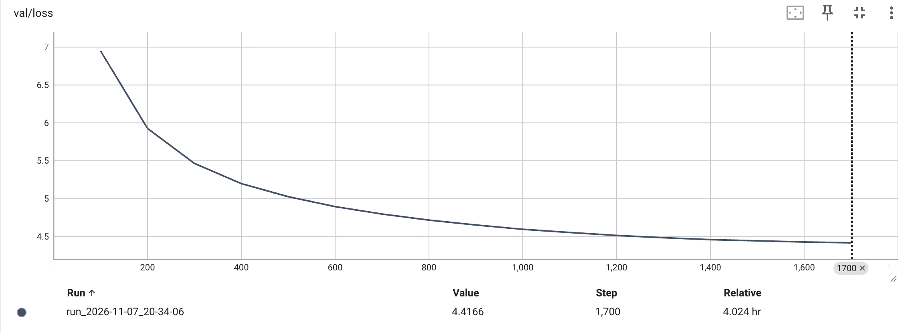

**No CUDA, no WebText, no `from_pretrained`.** A 6.9M-parameter GPT-2, its byte-level BPE tokenizer included, written in plain PyTorch and pre-trained from random weights on Bengali Wikipedia on a single 16GB M1. It learned how a Bengali Wikipedia article is written. It did not learn what is true.

[Source on GitHub](https://github.com/SamyamoyRakshit/papers-from-scratch/tree/main/GPT)


## 1 Start with the result

The model was scored on the 1,621 Wikipedia articles it never trained on, the same validation split [BERT](https://samyamoyrakshit.com/blog/bert-from-scratch/) used:

| model | bits per byte |
|---|---|
| uniform: all 8,192 tokens equally likely | 1.3353 |
| unigram: how common each token is, no context | 1.1592 |
| **this GPT, after 1,700 steps** | **0.6545** |

Bits per byte is the model's total surprise divided by the size of the text, so it doesn't depend on how the tokenizer cut the text; GPT-2's Table 3 uses the same unit. Per token, the same result is a loss of 4.4166 nats, perplexity 82.8: on average the model is as unsure as a fair pick among 83 tokens. None of this compares with English results, because a Bengali letter takes 3 bytes in UTF-8.

Here is what that buys. Given the prompt রবীন্দ্রনাথ ঠাকুর (Rabindranath Tagore), at temperature 0.8 and top-k 40, the first of two samples drawn with seed 1:

> রবীন্দ্রনাথ ঠাকুর (জ.০২/১৯০৯) ছিলেন একজন বাঙালি কবি। তার বাবার নাম ছিল রবীন্দ্রনাথ ঠাকুর। তার লেখা বই বাংলা ভাষায় অনুবাদক ছিলেন। তার প্রথম বই, যা ছিল বইটির নাম হল 'মহংসী নজরুল। তিনি ছিলেন একজন শিক্ষিতযজ্ঞের। তার পিতা ছিলেন রামচন্দ্র চট্টোপাধ্যায়
>
> *Rabindranath Tagore (b. 02/1909) was a Bengali poet. His father's name was Rabindranath Tagore. His written books were translator in the Bengali language. His first book, which was the book's name is 'Mahangsi Nazrul. He was an educated-yajna. His father was Ramchandra Chattopadhyay*

**The form is right.** It opens like a Wikipedia biography: the name, a birth date in parentheses after জ. ("born"), "was a Bengali poet", then his father and his books. Almost every word is a real Bengali word, and the sentences end in `।`.

**The facts are wrong.** Tagore was born in 1861, and his father was Debendranath Tagore. The sample gives 1909 and two other fathers, one of them Tagore himself. The grammar holds for a sentence or two, then slips. The second sample was worse: ঠাকুর, over and over ([section 6](#6-what-it-learned-and-what-it-didnt)).

That's what to expect at this size. GPT-2's smallest model is 18 times larger and read 40 GB of WebText; this one read 11 million tokens of Bengali Wikipedia, ten times over. So this post stays short, and keeps to what the build turned up: a tokenizer rule that breaks on Bengali, the three changes GPT-2 made to the decoder, and what CUDA's speed tricks do on a laptop.

---

## 2 Same data, same size as BERT, one mask apart

The [BERT post](https://samyamoyrakshit.com/blog/bert-from-scratch/) ended on one line: bidirectionality is a mask you omit. This post is the other half, the mask passed. GPT trains on the same 16,213 Bengali Wikipedia articles, holds out the same 1,621, and has the same six layers, 256 wide, with eight heads. That makes the two posts one controlled comparison:

| | BERT (2018) | GPT-2 (2019) |
|---|---|---|
| attention | every token sees every token | each token sees only the ones before it |
| trained to | fill in masked tokens; tell whether B follows A | predict the next token, at every position |
| LayerNorm | after each sub-layer | before each sub-layer, plus one at the end |
| tokenizer | WordPiece, 10k | byte-level BPE, 8,192 |
| parameters here | 7,573,266 | 6,901,760 |
| result here | 86.5% on IndicGLUE `sna.bn`, fine-tuned | 0.6545 bits/byte, and the sample above |

Their losses can't be compared: BERT predicts 15% of the tokens with both sides visible, GPT predicts every token from the left alone.

What GPT-2 kept from the earlier models is imported unchanged from those posts' code: LayerNorm and the causal mask from the [Transformer](https://samyamoyrakshit.com/blog/attention-from-scratch/), GELU and the weight-decay split from BERT. Everything else is written by hand here: the tokenizer, the attention with its fused QKV, the decoder block, the model, the training loop and the sampler.

---

## 3 The architecture

GPT-2 is GPT-1's decoder, scaled up, with three changes. Here it is at the size that fits a 16GB M1, with আমি কলকাতা যাব ("I will go to Kolkata") going in at the top:

<style>
  /* Presentation attributes on each element are the always-works layer (plain
     hex, survives any renderer that strips this block). These rules re-style the
     same elements through the site tokens. CSS beats a presentation attribute,
     so on the site the diagram themes with the ThemeToggle. */
  .dgm{background:var(--code-bg, oklch(0.97 0.0022 95));border:1px solid var(--rule, oklch(0.868 0.0038 95));border-radius:14px;padding:20px 14px;overflow-x:auto;margin:1.6rem 0}
  .dgm svg{display:block;width:100%;height:auto;margin:0 auto}
  .dgm text{font-family:var(--f-mono, ui-monospace,SFMono-Regular,Menlo,monospace)}
  .dg-xink{fill:var(--ink, oklch(0.23 0.023 258))}
  .dg-xmut{fill:var(--ink-muted, oklch(0.42 0.021 258))}
  .dg-xaccent{fill:var(--accent, oklch(0.47 0.175 268))}
  .dg-xamberfg{fill:var(--tint-amber-fg, oklch(0.445 0.09 65))}
  .dg-xskyfg{fill:var(--tint-sky-fg, oklch(0.435 0.114 250))}
  .dg-xvioletfg{fill:var(--tint-violet-fg, oklch(0.44 0.145 300))}
  .dg-xmintfg{fill:var(--tint-mint-fg, oklch(0.42 0.081 168))}
  .dg-node{fill:var(--paper-sunken, oklch(0.902 0.0034 95));stroke:var(--rule, oklch(0.868 0.0038 95))}
  .dg-amber{fill:var(--tint-amber-bg, oklch(0.942 0.042 85));stroke:var(--tint-amber-fg, oklch(0.445 0.09 65))}
  .dg-sky{fill:var(--tint-sky-bg, oklch(0.933 0.033 245));stroke:var(--tint-sky-fg, oklch(0.435 0.114 250))}
  .dg-violet{fill:var(--tint-violet-bg, oklch(0.933 0.031 300));stroke:var(--tint-violet-fg, oklch(0.44 0.145 300))}
  .dg-mintbox{fill:var(--tint-mint-bg, oklch(0.933 0.035 165));stroke:var(--tint-mint-fg, oklch(0.42 0.081 168))}
  .dg-flow{stroke:var(--ink-muted, oklch(0.42 0.021 258))}
  .dg-mem{stroke:var(--accent, oklch(0.47 0.175 268))}
  .dg-tie{stroke:var(--tint-amber-fg, oklch(0.445 0.09 65))}
  .dg-group{stroke:var(--rule-strong, oklch(0.615 0.006 95))}
  .dg-ahflow{fill:var(--ink-muted, oklch(0.42 0.021 258))}
  .dg-ahmem{fill:var(--accent, oklch(0.47 0.175 268))}
  /* On a phone, scroll the diagram rather than shrink it, as in the earlier
     posts: this viewBox is 700 wide, and fitting it into a 358px column scales
     the 10.5-15px labels down to 5-7px. The container already scrolls. */
  @media (max-width: 40rem){
    .dgm svg{min-width:620px}
  }
</style>
<figure class="dgm">
  <svg viewBox="0 0 700 836" width="700" height="836" style="max-width:100%;height:auto" font-family="ui-monospace, SFMono-Regular, Menlo, Consolas, monospace" role="img" aria-label="GPT-2 as built here. Bengali text is cut by a byte-level BPE tokenizer into token ids, embedded with a token table plus a learned position table, and passed through 6 decoder blocks. Each block applies LayerNorm then masked self-attention, where a token sees only the tokens before it, and LayerNorm then an MLP, each added back to a residual stream. A final LayerNorm and an output layer that reuses the token table give scores over 8,192 tokens for the next token at every position. Tags mark GPT-2's changes: pre-norm LayerNorm, the added final LayerNorm, and the residual init scaled by 1 over the square root of 12, plus the tokenizer's fixed regex.">
    <defs><marker id="dgahG-flow" viewBox="0 0 9 9" refX="7.5" refY="4.5" markerWidth="6.5" markerHeight="6.5" orient="auto-start-reverse"><path class="dg-ahflow" d="M0,0 L9,4.5 L0,9 z" fill="#464e59"/></marker><marker id="dgahG-res" viewBox="0 0 9 9" refX="7.5" refY="4.5" markerWidth="6.5" markerHeight="6.5" orient="auto-start-reverse"><path class="dg-ahmem" d="M0,0 L9,4.5 L0,9 z" fill="#324ebb"/></marker></defs>
    <rect class="dg-node" x="170" y="14" width="340" height="50" rx="12" fill="#dfdfdc" stroke="#d4d3d1" stroke-width="1.4"/>
    <text class="dg-xink" x="340" y="37" fill="#161d28" font-size="15" font-weight="600" text-anchor="middle">আমি কলকাতা যাব</text>
    <text class="dg-xink" x="340" y="55" fill="#161d28" font-size="11" font-weight="400" text-anchor="middle">“I will go to Kolkata”</text>
    <text class="dg-xmut" x="528" y="36" fill="#464e59" font-size="11" font-weight="400" text-anchor="start">UTF-8 text,</text>
    <text class="dg-xmut" x="528" y="51" fill="#464e59" font-size="10.5" font-weight="400" text-anchor="start">3 bytes per letter</text>
    <path class="dg-flow" d="M340,64 L340,88" fill="none" stroke="#464e59" stroke-width="1.8" stroke-linecap="round" marker-end="url(#dgahG-flow)"/>
    <rect class="dg-mintbox" x="170" y="90" width="340" height="64" rx="12" fill="#d4f1e3" stroke="#0b5b44" stroke-width="1.4"/>
    <text class="dg-xmintfg" x="340" y="112" fill="#0b5b44" font-size="14" font-weight="600" text-anchor="middle">Byte-level BPE tokenizer</text>
    <text class="dg-xmintfg" x="340" y="131" fill="#0b5b44" font-size="12.5" font-weight="400" text-anchor="middle">আ · মি · ␣কলকাতা · ␣যাব</text>
    <text class="dg-xmintfg" x="340" y="147" fill="#0b5b44" font-size="11" font-weight="400" text-anchor="middle">ids 844 · 3300 · 1636 · 6464</text>
    <text class="dg-xaccent" x="150" y="122" fill="#324ebb" font-size="11" font-weight="600" text-anchor="end">GPT-2 §2.2</text>
    <text class="dg-xmut" x="150" y="137" fill="#464e59" font-size="10.5" font-weight="400" text-anchor="end">fixed regex</text>
    <text class="dg-xmut" x="528" y="122" fill="#464e59" font-size="11" font-weight="400" text-anchor="start" letter-spacing=".02em">(B, T) ids</text>
    <text class="dg-xmut" x="528" y="137" fill="#464e59" font-size="10.5" font-weight="400" text-anchor="start">T ≤ 256</text>
    <path class="dg-flow" d="M340,154 L340,178" fill="none" stroke="#464e59" stroke-width="1.8" stroke-linecap="round" marker-end="url(#dgahG-flow)"/>
    <rect class="dg-sky" x="170" y="180" width="340" height="64" rx="12" fill="#d7ecfe" stroke="#0f538d" stroke-width="1.4"/>
    <text class="dg-xskyfg" x="340" y="202" fill="#0f538d" font-size="14" font-weight="600" text-anchor="middle">Token + position embedding</text>
    <text class="dg-xskyfg" x="340" y="219" fill="#0f538d" font-size="11" font-weight="400" text-anchor="middle">wte 8,192 × 256 + wpe 256 × 256</text>
    <text class="dg-xskyfg" x="340" y="234" fill="#0f538d" font-size="11" font-weight="400" text-anchor="middle">summed, then dropout 0.1</text>
    <text class="dg-xmut" x="528" y="216" fill="#464e59" font-size="11" font-weight="400" text-anchor="start" letter-spacing=".02em">(B, T, 256)</text>
    <rect class="dg-group" x="170" y="270" width="340" height="334" rx="14" fill="none" stroke="#868581" stroke-width="1.3" stroke-dasharray="5 4"/>
    <text class="dg-xvioletfg" x="528" y="292" fill="#603995" font-size="12" font-weight="700" text-anchor="start" letter-spacing=".12em">DECODER BLOCK × 6</text>
    <text class="dg-xmut" x="528" y="309" fill="#464e59" font-size="10.5" font-weight="400" text-anchor="start">6 copies, own weights</text>
    <path class="dg-flow" d="M340,244 L340,304" fill="none" stroke="#464e59" stroke-width="1.8" stroke-linecap="round" marker-end="url(#dgahG-flow)"/>
    <path class="dg-mem" d="M340,286 H192 V424 H328" fill="none" stroke="#324ebb" stroke-width="2.2" stroke-linecap="round" stroke-linejoin="round" marker-end="url(#dgahG-res)"/>
    <circle class="dg-ahmem" cx="340" cy="286" r="3.2" fill="#324ebb"/>
    <rect class="dg-violet" x="215" y="306" width="250" height="30" rx="9" fill="#ece5fb" stroke="#603995" stroke-width="1.4"/>
    <text class="dg-xvioletfg" x="340" y="326" fill="#603995" font-size="14" font-weight="600" text-anchor="middle">LayerNorm</text>
    <text class="dg-xaccent" x="150" y="318" fill="#324ebb" font-size="11" font-weight="600" text-anchor="end">GPT-2 §2.3</text>
    <text class="dg-xmut" x="150" y="333" fill="#464e59" font-size="10.5" font-weight="400" text-anchor="end">pre-norm</text>
    <path class="dg-flow" d="M340,336 L340,350" fill="none" stroke="#464e59" stroke-width="1.8" stroke-linecap="round" marker-end="url(#dgahG-flow)"/>
    <rect class="dg-violet" x="215" y="352" width="250" height="46" rx="10" fill="#ece5fb" stroke="#603995" stroke-width="1.4"/>
    <text class="dg-xvioletfg" x="340" y="374" fill="#603995" font-size="14" font-weight="600" text-anchor="middle">Masked self-attention</text>
    <text class="dg-xvioletfg" x="340" y="391" fill="#603995" font-size="11" font-weight="400" text-anchor="middle">8 heads × 32 dims</text>
    <rect class="dg-xvioletfg" x="530" y="355" width="7" height="7" rx="1.5" fill="#603995"/>
    <rect class="dg-violet" x="538" y="355" width="7" height="7" rx="1.5" fill="#ece5fb" stroke="#603995" stroke-width="0.6"/>
    <rect class="dg-violet" x="546" y="355" width="7" height="7" rx="1.5" fill="#ece5fb" stroke="#603995" stroke-width="0.6"/>
    <rect class="dg-violet" x="554" y="355" width="7" height="7" rx="1.5" fill="#ece5fb" stroke="#603995" stroke-width="0.6"/>
    <rect class="dg-violet" x="562" y="355" width="7" height="7" rx="1.5" fill="#ece5fb" stroke="#603995" stroke-width="0.6"/>
    <rect class="dg-xvioletfg" x="530" y="363" width="7" height="7" rx="1.5" fill="#603995"/>
    <rect class="dg-xvioletfg" x="538" y="363" width="7" height="7" rx="1.5" fill="#603995"/>
    <rect class="dg-violet" x="546" y="363" width="7" height="7" rx="1.5" fill="#ece5fb" stroke="#603995" stroke-width="0.6"/>
    <rect class="dg-violet" x="554" y="363" width="7" height="7" rx="1.5" fill="#ece5fb" stroke="#603995" stroke-width="0.6"/>
    <rect class="dg-violet" x="562" y="363" width="7" height="7" rx="1.5" fill="#ece5fb" stroke="#603995" stroke-width="0.6"/>
    <rect class="dg-xvioletfg" x="530" y="371" width="7" height="7" rx="1.5" fill="#603995"/>
    <rect class="dg-xvioletfg" x="538" y="371" width="7" height="7" rx="1.5" fill="#603995"/>
    <rect class="dg-xvioletfg" x="546" y="371" width="7" height="7" rx="1.5" fill="#603995"/>
    <rect class="dg-violet" x="554" y="371" width="7" height="7" rx="1.5" fill="#ece5fb" stroke="#603995" stroke-width="0.6"/>
    <rect class="dg-violet" x="562" y="371" width="7" height="7" rx="1.5" fill="#ece5fb" stroke="#603995" stroke-width="0.6"/>
    <rect class="dg-xvioletfg" x="530" y="379" width="7" height="7" rx="1.5" fill="#603995"/>
    <rect class="dg-xvioletfg" x="538" y="379" width="7" height="7" rx="1.5" fill="#603995"/>
    <rect class="dg-xvioletfg" x="546" y="379" width="7" height="7" rx="1.5" fill="#603995"/>
    <rect class="dg-xvioletfg" x="554" y="379" width="7" height="7" rx="1.5" fill="#603995"/>
    <rect class="dg-violet" x="562" y="379" width="7" height="7" rx="1.5" fill="#ece5fb" stroke="#603995" stroke-width="0.6"/>
    <rect class="dg-xvioletfg" x="530" y="387" width="7" height="7" rx="1.5" fill="#603995"/>
    <rect class="dg-xvioletfg" x="538" y="387" width="7" height="7" rx="1.5" fill="#603995"/>
    <rect class="dg-xvioletfg" x="546" y="387" width="7" height="7" rx="1.5" fill="#603995"/>
    <rect class="dg-xvioletfg" x="554" y="387" width="7" height="7" rx="1.5" fill="#603995"/>
    <rect class="dg-xvioletfg" x="562" y="387" width="7" height="7" rx="1.5" fill="#603995"/>
    <text class="dg-xmut" x="580" y="370" fill="#464e59" font-size="11" font-weight="400" text-anchor="start">causal mask</text>
    <text class="dg-xmut" x="580" y="385" fill="#464e59" font-size="10.5" font-weight="400" text-anchor="start">token t sees 0…t</text>
    <path class="dg-flow" d="M340,398 L340,412" fill="none" stroke="#464e59" stroke-width="1.8" stroke-linecap="round" marker-end="url(#dgahG-flow)"/>
    <circle class="dg-node dg-mem" cx="340" cy="424" r="10" fill="#dfdfdc" stroke="#324ebb" stroke-width="1.6"/>
    <path class="dg-mem" d="M335,424 H345 M340,419 V429" fill="none" stroke="#324ebb" stroke-width="1.8" stroke-linecap="round"/>
    <text class="dg-xmut" x="528" y="428" fill="#464e59" font-size="11" font-weight="400" text-anchor="start" letter-spacing=".02em">(B, T, 256)</text>
    <path class="dg-flow" d="M340,434 L340,458" fill="none" stroke="#464e59" stroke-width="1.8" stroke-linecap="round" marker-end="url(#dgahG-flow)"/>
    <path class="dg-mem" d="M340,446 H192 V578 H328" fill="none" stroke="#324ebb" stroke-width="2.2" stroke-linecap="round" stroke-linejoin="round" marker-end="url(#dgahG-res)"/>
    <circle class="dg-ahmem" cx="340" cy="446" r="3.2" fill="#324ebb"/>
    <rect class="dg-violet" x="215" y="460" width="250" height="30" rx="9" fill="#ece5fb" stroke="#603995" stroke-width="1.4"/>
    <text class="dg-xvioletfg" x="340" y="480" fill="#603995" font-size="14" font-weight="600" text-anchor="middle">LayerNorm</text>
    <path class="dg-flow" d="M340,490 L340,504" fill="none" stroke="#464e59" stroke-width="1.8" stroke-linecap="round" marker-end="url(#dgahG-flow)"/>
    <rect class="dg-violet" x="215" y="506" width="250" height="46" rx="10" fill="#ece5fb" stroke="#603995" stroke-width="1.4"/>
    <text class="dg-xvioletfg" x="340" y="528" fill="#603995" font-size="14" font-weight="600" text-anchor="middle">MLP</text>
    <text class="dg-xvioletfg" x="340" y="545" fill="#603995" font-size="11" font-weight="400" text-anchor="middle">256 → 1,024 → 256, GELU</text>
    <path class="dg-flow" d="M340,552 L340,566" fill="none" stroke="#464e59" stroke-width="1.8" stroke-linecap="round" marker-end="url(#dgahG-flow)"/>
    <circle class="dg-node dg-mem" cx="340" cy="578" r="10" fill="#dfdfdc" stroke="#324ebb" stroke-width="1.6"/>
    <path class="dg-mem" d="M335,578 H345 M340,573 V583" fill="none" stroke="#324ebb" stroke-width="1.8" stroke-linecap="round"/>
    <text class="dg-xaccent" x="150" y="574" fill="#324ebb" font-size="11" font-weight="600" text-anchor="end">GPT-2 §2.3</text>
    <text class="dg-xmut" x="150" y="589" fill="#464e59" font-size="10.5" font-weight="400" text-anchor="end">init ÷ √12</text>
    <path class="dg-flow" d="M340,588 L340,628" fill="none" stroke="#464e59" stroke-width="1.8" stroke-linecap="round" marker-end="url(#dgahG-flow)"/>
    <rect class="dg-violet" x="170" y="630" width="340" height="40" rx="11" fill="#ece5fb" stroke="#603995" stroke-width="1.4"/>
    <text class="dg-xvioletfg" x="340" y="655" fill="#603995" font-size="14" font-weight="600" text-anchor="middle">Final LayerNorm</text>
    <text class="dg-xaccent" x="150" y="647" fill="#324ebb" font-size="11" font-weight="600" text-anchor="end">GPT-2 §2.3</text>
    <text class="dg-xmut" x="150" y="662" fill="#464e59" font-size="10.5" font-weight="400" text-anchor="end">added</text>
    <path class="dg-flow" d="M340,670 L340,694" fill="none" stroke="#464e59" stroke-width="1.8" stroke-linecap="round" marker-end="url(#dgahG-flow)"/>
    <rect class="dg-amber" x="170" y="696" width="340" height="50" rx="12" fill="#f9eacd" stroke="#754812" stroke-width="1.4"/>
    <text class="dg-xamberfg" x="340" y="718" fill="#754812" font-size="14" font-weight="600" text-anchor="middle">Output layer, tied</text>
    <text class="dg-xamberfg" x="340" y="735" fill="#754812" font-size="11" font-weight="400" text-anchor="middle">256 → 8,192, weight = wteᵀ, no bias</text>
    <text class="dg-xmut" x="528" y="726" fill="#464e59" font-size="11" font-weight="400" text-anchor="start" letter-spacing=".02em">(B, T, 8192)</text>
    <path class="dg-tie" d="M170,721 H36 V212 H170" fill="none" stroke="#754812" stroke-width="1.8" stroke-dasharray="5 4" stroke-linejoin="round"/>
    <circle class="dg-xamberfg" cx="170" cy="721" r="3.2" fill="#754812"/>
    <circle class="dg-xamberfg" cx="170" cy="212" r="3.2" fill="#754812"/>
    <text class="dg-xamberfg" x="28" y="466" transform="rotate(-90 28 466)" fill="#754812" font-size="11" font-weight="400" text-anchor="middle">tied: one 8,192 × 256 table</text>
    <path class="dg-flow" d="M340,746 L340,770" fill="none" stroke="#464e59" stroke-width="1.8" stroke-linecap="round" marker-end="url(#dgahG-flow)"/>
    <rect class="dg-node" x="170" y="772" width="340" height="50" rx="12" fill="#dfdfdc" stroke="#d4d3d1" stroke-width="1.4"/>
    <text class="dg-xink" x="340" y="794" fill="#161d28" font-size="14" font-weight="600" text-anchor="middle">Next token, at every position</text>
    <text class="dg-xink" x="340" y="812" fill="#161d28" font-size="12" font-weight="400" text-anchor="middle">আ→মি · মি→␣কলকাতা · ␣কলকাতা→␣যাব</text>
    <text class="dg-xmut" x="528" y="794" fill="#464e59" font-size="11" font-weight="400" text-anchor="start">train: cross-entropy</text>
    <text class="dg-xmut" x="528" y="809" fill="#464e59" font-size="11" font-weight="400" text-anchor="start">generate: sample, append</text>
  </svg>
</figure>

The whole model is GPT-1's Eq. 2, with GPT-2's final LayerNorm added in the last line:

$$
\begin{aligned}
h_0 &= U W_e + W_p \\
h_l &= \operatorname{block}(h_{l-1}), \qquad l = 1 \ldots 6 \\
P(u) &= \operatorname{softmax}\big(\operatorname{LN}(h_6)\, W_e^{\top}\big)
\end{aligned}
$$

$U$ is the token ids, $W_e$ the 8,192 × 256 token table, $W_p$ the 256 × 256 position table. $W_e$ appears twice: the output layer is the token table, transposed. That's weight tying, the dashed line on the left of the diagram.

Training maximizes GPT-1's Eq. 1, the log-probability of each token given the ones before it. One forward pass scores all 256 positions at once: the target at each position is the token after it, and the causal mask is what stops a position from seeing that answer.

### 3.1 What GPT-2 changed

Section 2.3 of the paper changes GPT-1's block in three sentences, each tagged GPT-2 §2.3 on the diagram:

1. **LayerNorm moves to the input of each sub-block (pre-norm).** The residual stream itself is never normalized, so it runs clean from the embeddings to the top.
2. **One more LayerNorm after the last block,** since nothing else normalizes the stream before the output layer.
3. **The Linear just before each residual add starts 1/√N smaller,** where N counts the adds: two per block, so N = 12 here. Every add makes the un-normalized stream bigger, and the scaling holds that growth down. Measured at initialization, the stream's standard deviation goes from 0.0283 after the embeddings to 0.0876 after six blocks; with the plain 0.02 init it reaches 0.3152. With 48 blocks the scaled stream ends at 0.0893, nearly the same as with six: its final size barely depends on depth.

The rest is GPT-1: learned positions, GELU, every other weight drawn from N(0, 0.02). The small init shows at step 0. A model that knows nothing should score ln 8,192 = 9.0109, and this one starts at 9.0514.

GPT-2 also widened the vocabulary to 50,257 tokens and the context to 1,024. Both are scaled down here ([section 5](#5-training-4-h-15-m-on-one-m1)).

### 3.2 Where 6,901,760 parameters live

| part | parameters |
|---|---|
| token table `wte`, 8,192 × 256 | 2,097,152 |
| position table `wpe`, 256 × 256 | 65,536 |
| 6 decoder blocks × 789,760 | 4,738,560 |
| final LayerNorm | 512 |
| output layer: the token table again | 0 |
| **total** | **6,901,760** |

Untied, the output layer would be another 2,097,152 parameters, 23% of an untied model. The token table alone is 30% of it, almost exactly its share of GPT-2 small (31%).

---

## 4 A tokenizer that cut Bengali at every vowel sign

GPT-2's tokenizer works in two steps. A regex first cuts the text into chunks, roughly words. Byte-level BPE then learns merges inside each chunk, never across two, so the regex decides what a token can ever be. OpenAI's pattern:

```
's|'t|'re|'ve|'m|'ll|'d| ?\p{L}+| ?\p{N}+| ?[^\s\p{L}\p{N}]+|\s+(?!\S)|\s+
```

Its word class is `\p{L}`, Unicode letters. In Bengali, only consonants and independent vowels are letters. Vowel signs, the hasanta `্` that builds every conjunct, and the nukta `়` are marks, `\p{M}`. So `\p{L}+` stops at every vowel sign, and the sign falls through to the punctuation class:

```
"আমি কলকাতায় থাকি।"   ("I live in Kolkata.")

GPT-2's regex → ['আম', 'ি', ' কলক', 'া', 'ত', 'া', 'য', '়', ' থ', 'া', 'ক', 'ি।']
with \p{M}    → ['আমি', ' কলকাতায়', ' থাকি', '।']
```

Under GPT-2's pattern, no merge can ever join a consonant to its vowel sign, because the two never share a chunk. On the full corpus it makes 31,022,244 chunks, and the most common is `া` on its own, 3.0 million times. The fix adds `\p{M}` to the word class, along with the two zero-width joiners Bengali uses inside words: 8,058,024 chunks, 3.8× fewer, and the most common are now `।`, `,` and ` এবং` ("and"). The English contractions at the front of the pattern are gone too; Bengali has none.

BPE then trains on those chunks. The 256 byte values, 7,935 merges and `<|endoftext|>` make 8,192 tokens, sized to this corpus rather than GPT-2's 50,257. A token averages 9.8 bytes of text, about 3.8 Bengali characters. The diagram's sentence comes out as `আ · মি · ␣কলকাতা · ␣যাব`: the city is one token, and আমি ("I") is two only because it opens the text. Mid-sentence, ` আমি` with its space is one token.

---

## 5 Training: 4 h 15 m on one M1

GPT-2 states one training number, the batch: 512 sequences of 1,024 tokens. For the rest I used GPT-3's Appendix B, as Karpathy's build-nanoGPT does:

| | GPT-2 small (paper) | here |
|---|---|---|
| layers, width, heads | 12, 768, 12 | 6, 256, 8 |
| context | 1,024 | 256 |
| vocabulary | 50,257 | 8,192 |
| parameters | 117M (124M counted) | 6.9M |
| tokens per step | 524,288 | 65,536: 8 micro-batches of 32 × 256 |
| optimizer | not stated | AdamW, β (0.9, 0.95), weight decay 0.1, clip 1.0 |
| learning rate | tuned, value not given | 6e-4, 100 warmup steps, cosine to 10% |
| training text | WebText, 40 GB | Bengali Wikipedia, 11.0M tokens |
| run | not stated | 1,700 steps, 111.4M tokens (10 passes), 4 h 15 m |

<figure class="fig fig--credit">



<figcaption>

Validation loss on all 1.2M held-out tokens, every 100 steps. It improved at all 17 evaluations, so the last checkpoint is the best one. *Source: Image by Author, TensorBoard.*

</figcaption>

</figure>

Validation loss went from 6.95 at step 100 to 4.4166 at step 1,700, and was still falling when the schedule ran out. Ten passes over the same text had not started to hurt. Gradient clipping fired on 10 of the 1,700 steps, all of them in the warmup. A run interrupted and resumed from its last checkpoint continues with exactly the losses an uninterrupted run would have had.

### 5.1 What CUDA's speed tricks do on an M1

build-nanoGPT makes GPT-2 fast on 8 × A100 with bf16, `torch.compile` and FlashAttention. Measured on the M1, with PyTorch 2.12 on the MPS backend, none of the three helps:

| technique | on the M1 |
|---|---|
| bf16 | 1.7× slower than fp32: the M1's GPU has no native bf16, so it's emulated |
| `torch.compile` | about 25% less throughput, after a 270 s first compile |
| FlashAttention | not available. `scaled_dot_product_attention` runs, but its memory still grows with T²: 4.97 GB at 2,048 tokens (batch 8), out of memory at 8,192 |

That memory curve is why the context here is 256, not 1,024. The run is plain fp32 with SDPA, gradient accumulation, and the token files read through `np.memmap`, and it averaged about 7,300 tokens a second. One finding is measured but not yet used: fp16 runs a 4,096 × 4,096 matmul 1.24× faster than fp32, and SDPA survives the fp16 overflow behind the [Transformer post](https://samyamoyrakshit.com/blog/attention-from-scratch/)'s NaN at epoch 4, because it scales before the matmul instead of after.

### 5.2 Run it yourself

From the repo root, after `uv sync`:

```bash
python -m BERT.scripts.prepare_corpus            # Bengali Wikipedia, shared with BERT
python -m GPT.scripts.prepare_corpus             # <|endoftext|> after each article
python -m GPT.scripts.train_tokenizer            # byte-level BPE, 8,192 tokens, ~5 min
python -m GPT.scripts.prepare_data               # encode once: train.bin, val.bin
caffeinate -s python -m GPT.scripts.pretrain     # ~4 h 15 m on an M1
python -m GPT.scripts.evaluate                   # 0.6545 bits/byte
python -m GPT.scripts.generate --prompt "রবীন্দ্রনাথ ঠাকুর"
```

---

## 6 What it learned, and what it didn't

Taken apart, the held-out loss tells the same story as the sample.

**Context helps for about 32 tokens.** Loss by position in the 256-token window is 5.711 at the first position, 4.413 at position 32, and 4.340 at the last. Past a few dozen tokens, this model barely uses what it can see, so a longer context would buy little at this size.

**Starting a word is the hard part.** Tokens that begin a new word cost 5.34 nats on average; tokens that continue one cost 3.31. What the model predicts with confidence is grammar: the sentence-ending `।`, ` হয়` ("is"), ` সালে` ("in the year") after a date, ` করেন` ("does") closing a sentence. What it can't predict is which name, number or place comes next, which is exactly where the Tagore sample goes wrong. Almost half of the held-out tokens, 45.4%, got less than a 1% chance.

**Greedy decoding loops.** At temperature 0, রবীন্দ্রনাথ ঠাকুর continues ঠাকুর ঠাকুর ঠাকুর …, and কলকাতা continues কলকাতা, কলকাতা, কলকাতা, … Once a word repeats, repeating it again is the most likely next token, and greedy always takes the most likely. Over five unconditional samples, only 1% of greedy's 3-token sequences are distinct, against 82 to 91% when sampling. So `generate.yaml` samples, with top-k 40 like GPT-2's own samples. Sampling only makes loops rarer: the second sample at seed 1, at temperature 0.8, was the same ঠাকুর loop.

---

## 7 Where it falls short, and what's next

- **It stopped while still learning.** Validation loss improved at every evaluation. The cheapest next step is more steps on the same data: raise `max_steps` and resume, and the extra steps run at the schedule's 10% floor.
- **Wikipedia is all it has read,** so encyclopedia prose is all it can write, and ten passes over 11M tokens is a small, repeated diet. More Bengali text comes before a bigger model.
- **No zero-shot evaluation.** GPT-2's headline result is tasks done from a prompt with no fine-tuning (GPT-2 §3): reading comprehension, summarization, translation. This post measures held-out loss and reads samples, nothing more.
- **Generation recomputes everything.** Without a KV cache, each new token reruns the whole 256-token context: 10.8 ms, about 100 tokens a second. And fp16 ([section 5.1](#51-what-cudas-speed-tricks-do-on-an-m1)) is measured but not wired in.

---

## 8 Closing

Same articles, same six layers, one mask apart. The encoder became a classifier that placed above mBERT on a public leaderboard; the decoder became a fluent writer with nothing true to say. At 6.9M parameters that is the honest result, not a bug in the sampler. What's worth keeping is the build: a tokenizer rule that breaks on a script GPT-2's regex was never written for, three sentences of GPT-2's §2.3 measured instead of copied, and a list of CUDA speed tricks that don't survive the trip to a laptop. The code is on GitHub, one module per file, with every deviation from the paper flagged in `configs/base.yaml`.

---

## 9 References

1. Radford, A., Wu, J., Child, R., Luan, D., Amodei, D., Sutskever, I. (2019). *Language Models are Unsupervised Multitask Learners.* OpenAI. [PDF](https://cdn.openai.com/better-language-models/language_models_are_unsupervised_multitask_learners.pdf)
2. Radford, A., Narasimhan, K., Salimans, T., Sutskever, I. (2018). *Improving Language Understanding by Generative Pre-Training.* OpenAI. [PDF](https://cdn.openai.com/research-covers/language-unsupervised/language_understanding_paper.pdf)
3. Brown, T., Mann, B., Ryder, N., et al. (2020). *Language Models are Few-Shot Learners.* NeurIPS. [arXiv:2005.14165](https://arxiv.org/abs/2005.14165). Appendix B is the training recipe used here.
4. OpenAI. [`gpt-2/src/encoder.py`](https://github.com/openai/gpt-2/blob/master/src/encoder.py): the original pre-tokenizer regex.
5. Karpathy, A. [build-nanoGPT](https://github.com/karpathy/build-nanogpt): GPT-2 124M reproduced on 8 × A100, and the speed techniques measured in section 5.1.
6. Sennrich, R., Haddow, B., Birch, A. (2016). *Neural Machine Translation of Rare Words with Subword Units.* ACL. [arXiv:1508.07909](https://arxiv.org/abs/1508.07909)
7. Holtzman, A., Buys, J., Du, L., Forbes, M., Choi, Y. (2020). *The Curious Case of Neural Text Degeneration.* ICLR. [arXiv:1904.09751](https://arxiv.org/abs/1904.09751)
8. Unicode Consortium. [UAX #44, General Category values](https://www.unicode.org/reports/tr44/#General_Category_Values): letters (L), marks (M), numbers (N).
9. Devlin, J., Chang, M.-W., Lee, K., Toutanova, K. (2019). *BERT: Pre-training of Deep Bidirectional Transformers for Language Understanding.* NAACL. [arXiv:1810.04805](https://arxiv.org/abs/1810.04805)
10. Vaswani, A., et al. (2017). *Attention Is All You Need.* NeurIPS. [arXiv:1706.03762](https://arxiv.org/abs/1706.03762)
