**No JFT-300M, no TPU pod, no borrowed dataset.** ViT-Base/16 assembled from PyTorch layers on a single 16GB M1, and pointed at ten 17th- and 18th-century temples in Bishnupur, Bankura, West Bengal, India, from a dataset I built by hand.

[Source on GitHub](https://github.com/SamyamoyRakshit/papers-from-scratch/tree/main/ViT)


## 1. Start with the result

First, credit. The code in this post is not mine. It follows Daniel Bourke's [PyTorch Paper Replicating](https://www.learnpytorch.io/08_pytorch_paper_replicating/) chapter from *Zero to Mastery: Learn PyTorch* closely, training utilities included. That chapter is the best walkthrough of the paper I know, so if you want every cell explained at length, keep it open alongside this. What's mine is the data: ten temples, 1,935 images, sorted by hand. The data is what made the run worth writing up.

| model | weights at the start | parameters trained | test accuracy\* | what it actually did |
|---|---|---|---|---|
| ViT-Base/16, built in the notebook | random | 85,806,346 | 14.9% | answered "Jor Bangla" for all 392 test photos |
| ViT-B/16 from `torchvision`, frozen | ImageNet-1k | 7,690 | **88.9%** | learned the temples |

\* As logged by the notebook after epoch 10, on the 392-image test split.

The two `torchinfo` summaries agree to the parameter: 85,806,346 each. Same 1,543 training images, same ten epochs, same laptop. The only difference is where the weights started, and that difference is the ViT paper's central claim, reproduced in miniature on a dataset of my own.

Unlike the [Transformer](https://samyamoyrakshit.com/blog/attention-from-scratch/) and [BERT](https://samyamoyrakshit.com/blog/bert-from-scratch/) posts, attention here is PyTorch's own `nn.MultiheadAttention`. After building it by hand twice, what's new in ViT is how a picture becomes tokens, and what the model does with very little data. That's where this post spends its time.

---

## 2. Bishnupur, and the dataset

Bishnupur is a town in Bankura district, West Bengal, in eastern India, about 140 km (85 miles) northwest of Kolkata by road, and was the seat of the Malla kings of Mallabhum. The Mallas were Vaishnavas, and between the 17th and 18th centuries they filled their capital with temples. The ten in this dataset are only some of them; the ASI's map in section 3 marks others too: Radha Binode, Malleshwar temples, etc. With little good building stone to hand, they built in what the red ground gave them: laterite stone, locally called *makra*, and laterite bricks, which Bankura still makes today. They covered the walls in carved terracotta: battles, dancers, the *Ramayana* and the *Mahabharata*, and above all scenes from Krishna's life. The "Temples at Bishnupur" have been on UNESCO's World Heritage [tentative list](https://whc.unesco.org/en/tentativelists/1087/) since 1998. All ten in this dataset are ASI-protected Monuments of National Importance, notified in 1913 and 1914.

**Read the class names and you are reading the names of one god.** Shyam, Madan Mohan, Kalachand, Nandalal, Gobinda, Madhab: all names of Krishna, and Jor Bangla's traditional name, Kestaraya, is one too. The classes differ not in who they were built for, but in how they were built.

**That is also what makes this a hard vision problem.** Seven of the ten classes are the same kind of building: the single-towered *eka-ratna*. Six of those seven are built of laterite stone, and five of the six stand within about 450 metres of each other. Every class shares the same red-brown palette of brick and laterite. The model can't sort these by colour; it has to learn silhouettes, roof curves and the texture of the carving.

I assembled the dataset by hand: my own photographs from a visit in March 2025, plus images I collected one at a time. Every image was sorted into its temple's folder by hand. An 80/20 split per class (seed 42) gives the training and test sets:

| class | temple | type, per the ASI board | built | images | train | test |
|---|---|---|---|---|---|---|
| 0 | Jor Bangla | brick, two *dochala* roofs joined lengthwise | 1655 | 308 | 246 | 62 |
| 1 | Jor Mandir | three laterite-stone *eka-ratna* temples | 1726 (north temple) | 212 | 169 | 43 |
| 2 | Kalachand | laterite-stone *eka-ratna* | 1656 | 126 | 100 | 26 |
| 3 | Madan Mohan | brick *eka-ratna* | 1694 | 167 | 133 | 34 |
| 4 | Nandalal | laterite-stone *eka-ratna* | late 18th c. | 142 | 113 | 29 |
| 5 | Radha Gobinda | laterite-stone *eka-ratna* | 1726 | 149 | 119 | 30 |
| 6 | Radha Madhab | laterite-stone *eka-ratna* | 1737 | 139 | 111 | 28 |
| 7 | Radha Shyam | laterite-stone *eka-ratna* | 1758 | 182 | 145 | 37 |
| 8 | Rasmancha | brick, truncated pyramidal roof | c. 1600 by tradition | 194 | 155 | 39 |
| 9 | Shyam Rai | brick *pancha-ratna* (five towers) | 1643 | 316 | 252 | 64 |
| | **total** | | | **1,935** | **1,543** | **392** |

The class numbers are the labels the model sees. `ImageFolder` assigns them alphabetically by folder name, and they come up again when we read the results. The largest class is 2.5× the smallest (Shyam Rai 316, Kalachand 126).

**The dataset is not public, and I'm not releasing it.** The ten photographs below are the only images from it in this post. Nothing in the code depends on temples: point `ImageFolder` at any folder-per-class image set (yours, or the course's pizza/steak/sushi) and every cell runs unchanged.

---

## 3. The ten temples

Under each photo is the text of the Archaeological Survey of India's information board at that temple: the name, coordinates and description as written on site, transcribed from photographs. Capitals are normalised and obvious typos fixed; the separate protection-notice boards are left out. Visitors have been edited out of the photos. I photographed nine of the ten boards on 23 March 2025, between 1:19 and 3:01 in the afternoon.

The ASI also has an engraved map of the monuments it protects in the town. It puts the ten temples in three groups (the numbers are class labels). The distances are straight-line, worked out from the latitude and longitude printed on each board:

- **North:** Madan Mohan (3), on its own, about 950 m north of the centre group.
- **Centre, by the old fort gate:** Rasmancha (8), Shyam Rai (9), Jor Bangla (0) and Radha Shyam (7), within 635 m of each other. Jor Bangla and Radha Shyam stand 94 m apart.
- **South, beside the Lal Bandh reservoir:** Nandalal (4), Radha Gobinda (5), Jor Mandir (1), Radha Madhab (6) and Kalachand (2), within 432 m. All five are built of laterite stone.

End to end, from Madan Mohan to Kalachand, is 2.4 km.

<figure class="fig fig--credit">


<figcaption>

The ASI's map of Bishnupur's centrally protected monuments, straightened from a photo and cropped to the temples, with the glare on the granite cleaned out. The red circles and class numbers are mine. North is up. *Photo by the author, 23 March 2025.*

</figcaption>

</figure>

### 3.1 Jor Bangla

<figure class="fig fig--credit">

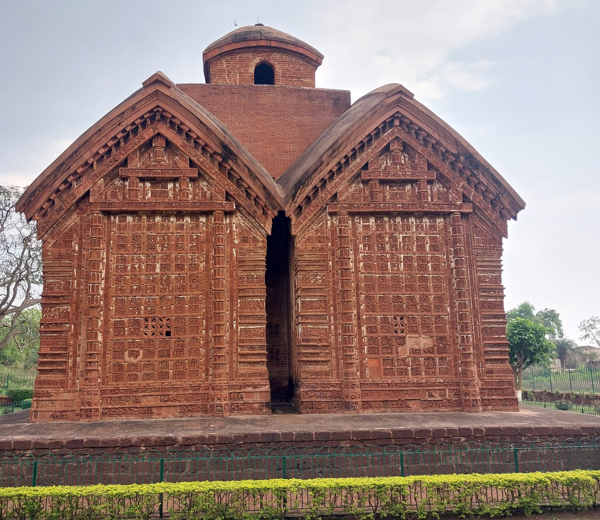

<figcaption>

Jor Bangla (class 0, 308 images). *Photo by the author, March 2025.*

</figcaption>

</figure>

> **JOR BANGLA TEMPLE** · Lat. 23°04′18.10″ N, Long. 87°19′36.44″ E
>
> Traditionally known as Kestaraya, this south-facing temple is famous for its structural features and exquisite terracotta embellishments. According to inscription, the temple was built by Raghunath Simha in 1655 CE. It is a composition of two large dochalas joined longitudinally: a small charchala, a brick replica of a four-sided roofed hut, marks its junction. Its outer dochala serves as the porch and the inner dochala as the sanctum. In the sanctum a stucco figure of six-armed Shri Chaitanya Deva is placed on a high pedestal against the back wall. The terracotta decoration includes scenes from the Mahabharata, Ramayana and Krishnalila. On walls east and west, timber frame on which dochalas rest has been efficiently translated into terracotta too.
>
> The temple was declared as a monument of national importance vide BG 4063, dated 18.8.1913.

### 3.2 Jor Mandir

<figure class="fig fig--credit">

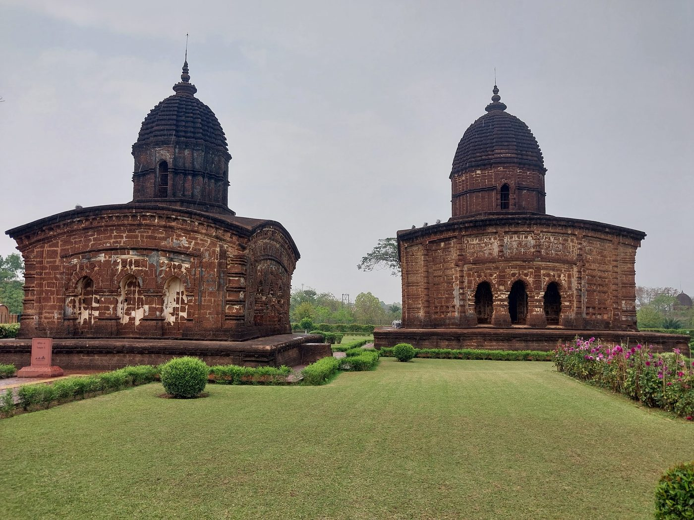

<figcaption>

Jor Mandir (class 1, 212 images). *Photo by the author, March 2025.*

</figcaption>

</figure>

> **JORAMANDIR COMPLEX** · Lat. 23°03′36.65″ N, Long. 87°19′18.81″ E
>
> In the eighteenth century the Malla kings of Bishnupur built the Joramandir group of temples, a complex of three ekaratna temples made of laterite, square in plan and constructed on a raised plinth. Among these, the two on the south and north are a little larger than the one in the middle. The temple on the northern side was built by Gopalasimha and his wife Dhvajamanidevi in 1726, according to inscription. The central one is elaborately decorated with stucco work, depicting scenes from Ramayana and Krishnalila.
>
> This group of temples were declared a monument of national importance vide BG 2351, dated 19.6.1914.

### 3.3 Kalachand

<figure class="fig fig--credit">

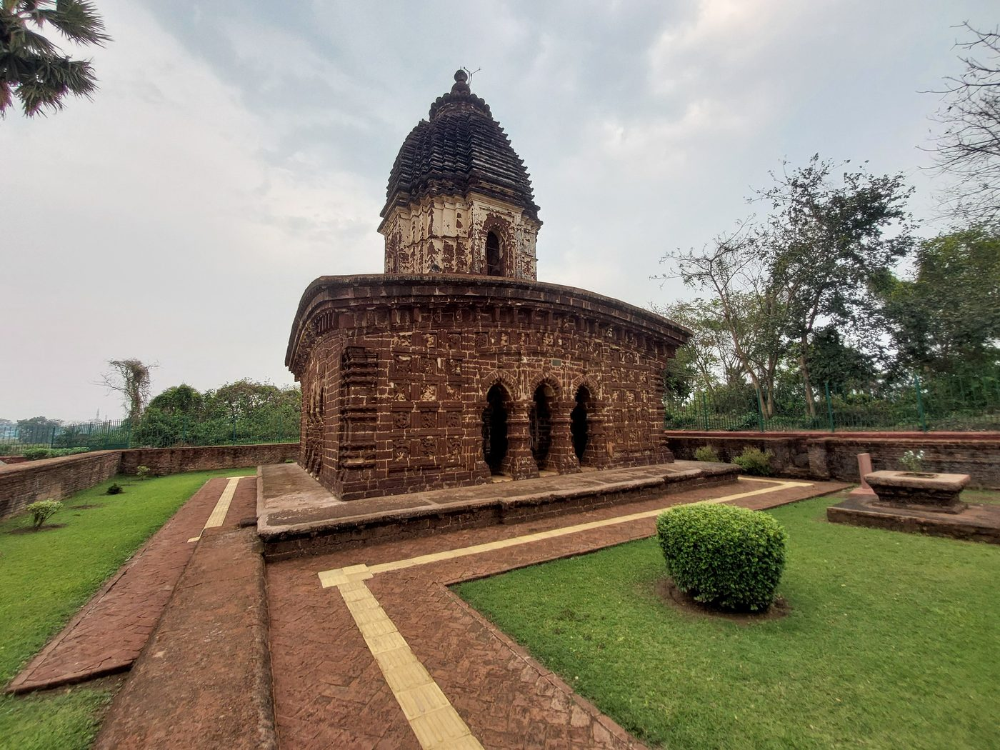

<figcaption>

Kalachand (class 2, 126 images). *Photo by the author, March 2025.*

</figcaption>

</figure>

> **KALACHAND TEMPLE** · Lat. 23°03′32.50″ N, Long. 87°19′33.33″ E
>
> This laterite temple of eka-ratna type is raised on a low platform and stands with corridor around with three arched openings on all four sides. The single tower having saptaratha plan is topped by an amalaka and a pitcher, rises from the centre of the curved roof. The decorations are mainly low-relief carvings with Krishnalila as the main theme and other representations of Pauranic deities, ascetics and dancers. Chaitanya, the famous medieval Bengali religious reformer, finds his place in the sculptural panel on the left frontal wall. This temple was built under the patronage of the Malla king Raghunatha Simha in the year 1656 CE.
>
> The temple was declared as a monument of national importance vide BG 2351, dated 19.6.1914.

### 3.4 Madan Mohan

<figure class="fig fig--credit">

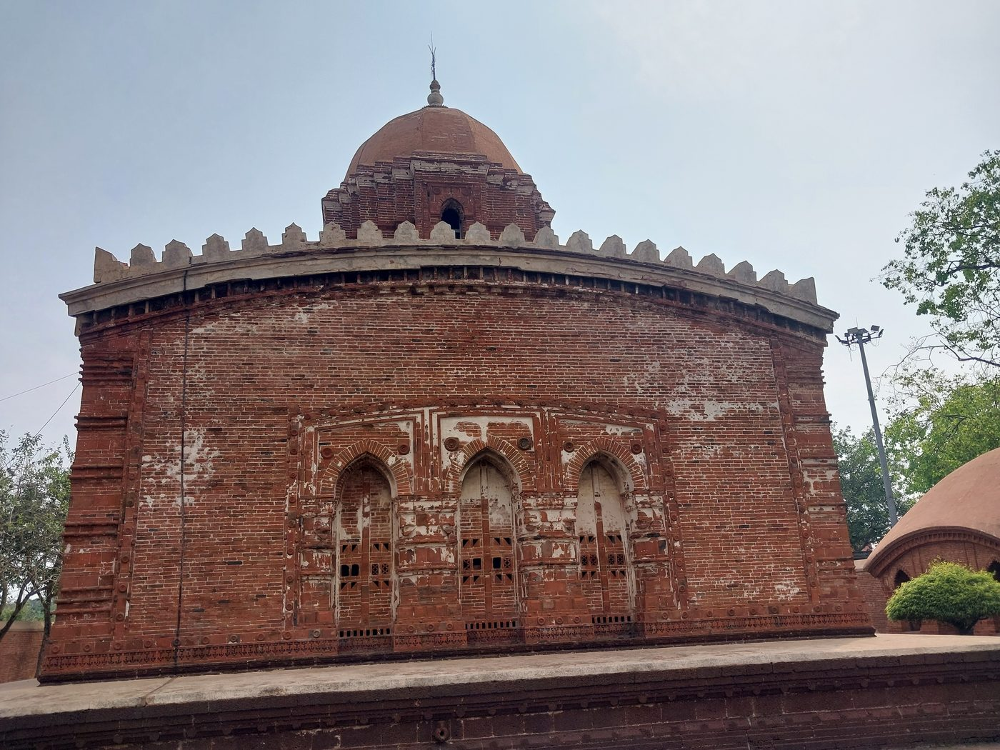

<figcaption>

Madan Mohan (class 3, 167 images). *Photo by the author, March 2025.*

</figcaption>

</figure>

> **MADAN MOHAN TEMPLE** · Lat. 23°04′50″ N, Long. 87°19′24″ E
>
> This brick built temple on a large laterite plinth was erected to enshrine the tutelary deity of the Mallas. The temple is much celebrated for the ornamentation works mainly on terracotta plaques which embellish its wall. The temple has covered porch with triple arched openings on the east, south and west and has a single tower on a sloping roof. The facade of the temple has scenes showing Krishnalila episodes, scenes showing dancers and dancing party and a row of ascetics. On the other three sides, the arches are fitted with plaques containing figures enclosed by very rich floral ornamentations. The area resting upon the arches are found covered with scenes depicting war while the lower panels are found decorated with figures of animals and birds, Krishnalila, Dasavatara scenes, legends and stories from the Puranas. The temple was built by Durjana Singha in 1694 CE as per inscriptional evidence.
>
> The temple was declared as a monument of national importance vide BG 4063, dated 18.8.1913.

### 3.5 Nandalal

<figure class="fig fig--credit">

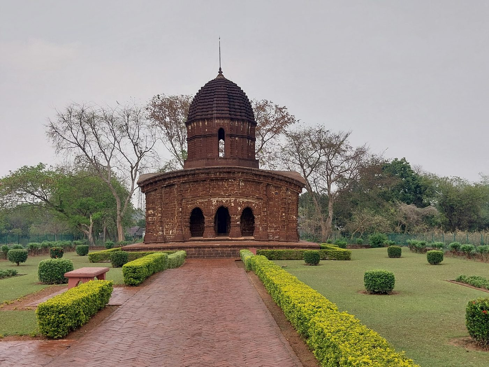

<figcaption>

Nandalal (class 4, 142 images). *Photo by the author, March 2025.*

</figcaption>

</figure>

> **NANDALAL TEMPLE** · Lat. 23°03′41.25″ N, Long. 87°19′22.96″ E
>
> A laterite structure, the temple is of the ekaratna type. This south facing temple has ornamentation only on the space available by the sides of the three arched openings. The temple has no foundation inscription but from the style and general appearance it seems that the edifice was built sometime during the late 18th century.
>
> The temple was declared as a monument of national importance vide BG 2351, dated 19.6.1914.

### 3.6 Radha Gobinda

<figure class="fig fig--credit">

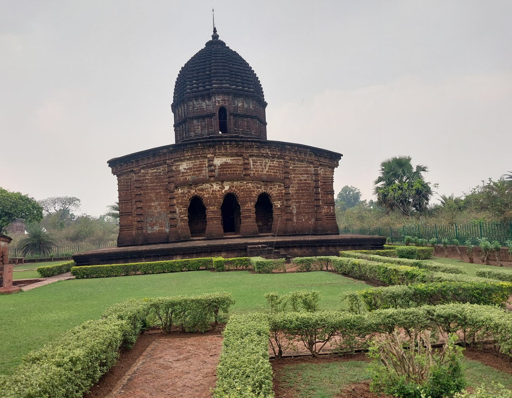

<figcaption>

Radha Gobinda (class 5, 149 images). *Photo by the author, March 2025.*

</figcaption>

</figure>

> **RADHAGOBINDA TEMPLE** · Lat. 23°03′36.49″ N, Long. 87°19′23.23″ E
>
> This east facing laterite temple of eka-ratna type is built on a square plan. The single tower rises from the center of the curved roof and topped by an amalaka and a pitcher. The temple has a triple arched facade with an oblong corridor right behind it. The entire front wall and the wall beneath the curved cornice are embellished with bas relief decoration. A brick built small chariot is found beside the temple. According to the temple inscription, the temple was built in 1726 CE during the reign of Krishna Simha.
>
> The temple was declared as a monument of national importance vide BG 2351, dated 19.6.1914.

### 3.7 Radha Madhab

<figure class="fig fig--credit">

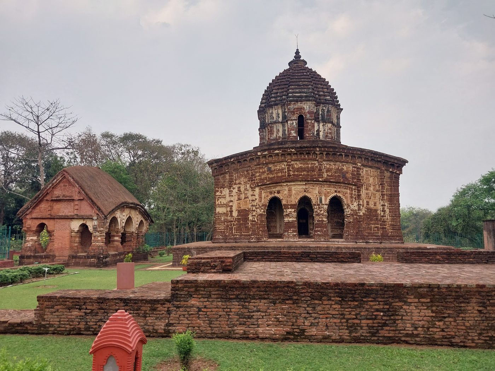

<figcaption>

Radha Madhab (class 6, 139 images). *Photo by the author, March 2025.*

</figcaption>

</figure>

> **RADHAMADHAB TEMPLE** · Lat. 23°03′34.59″ N, Long. 87°19′28.70″ E
>
> This laterite temple of ekaratna type with triple-arched opening in the south has access to the oblong corridor. The eastern wall of the temple has another corridor which has a three arched opening. At the base of the temple there are depicted rows of birds, animals and Puranic episodes. On the side wall and lower part of the cornice exist elaborate sculptural reliefs shown in a very graceful manner. The major area of these decorations is filled with scenes showing the Krishnalila episodes, Dasavatara and floral designs. A unique feature of this temple is the presence of a bhogamandapa (hall of offerings) of the dochala type. The temple was built by Churamonidevi, a consort of the Malla king Krishna Singha, in 1737 CE.
>
> The temple was declared as a monument of national importance vide BG 2351, dated 19.6.1914.

### 3.8 Radha Shyam

<figure class="fig fig--credit">

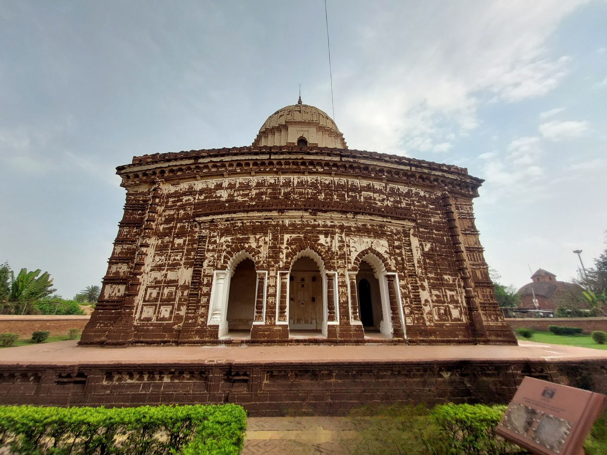

<figcaption>

Radha Shyam (class 7, 182 images). *Photo by the author, March 2025.*

</figcaption>

</figure>

> **RADHASHYAM TEMPLE** · Lat. 23°04′20.88″ N, Long. 87°19′35.11″ E
>
> This eka-ratna type of temple built in laterite is noted for its stucco reliefs. Built on a square plan, the temple has a curved roof with a single tower above. The lime plaster known as pankha applied to cover the laterite walls reveals decorations including geometric and floral motifs of exquisite workmanship. Two rows of stucco figures set up within square blocks are fixed along the side walls and the lower part of the cornice. Similar decorations can also be noticed along the sides of the three arched openings. The inner portion of the three arched porch are also decorated. The front wall of the sanctum is found decorated with scenes from the Ramayana, Anantasayin Vishnu and widely recurring figures of Radha Krishna. According to the dedicatory inscription of this temple, it was erected in the year 1758 CE by the Malla ruler Chaitanya Singha.
>
> The temple was declared as a monument of national importance vide BG 2351, dated 19.06.1914.

### 3.9 Rasmancha

<figure class="fig fig--credit">

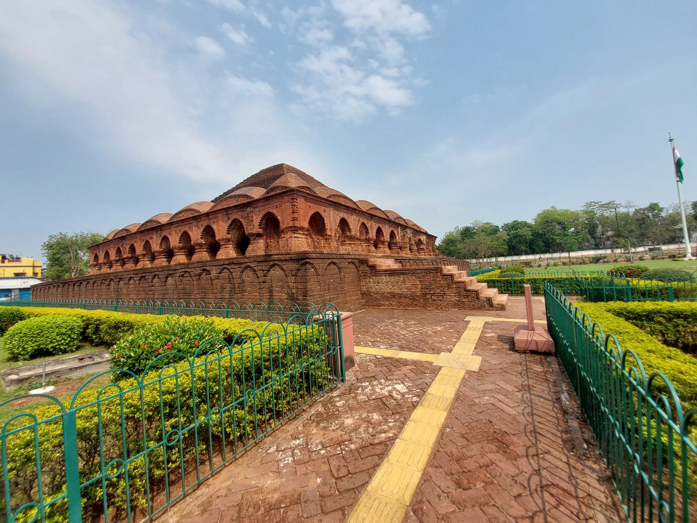

<figcaption>

Rasmancha (class 8, 194 images). *Photo by the author, March 2025.*

</figcaption>

</figure>

> **RASHMANCHA** · Lat. 23°04′06.16″ N, Long. 87°19′19.52″ E
>
> Built on a laterite plinth, the monument is an impressive brick built square structure with a small shrine at the center and three corridors around it. A triple-arched facade occurs on its four sides. The shrine in the center is approached through central arched opening on the south. The monument has a truncated pyramidal roof. Tradition suggests that the monument was built in c. 1600 CE. However, the blind arcade on the face of the plinth and many other architectural characteristics may suggest a later date, possibly in the late seventeenth century. The building was used for putting up idols from other temples on the occasion of Ras festival every year.
>
> The temple was declared as a monument of national importance vide BG 2351, dated 19.6.1914.

### 3.10 Shyam Rai

<figure class="fig fig--credit">

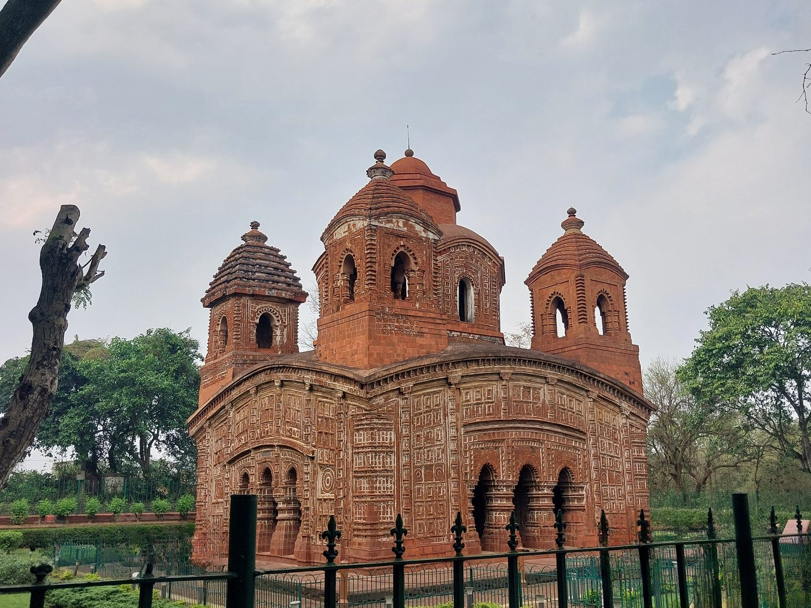

<figcaption>

Shyam Rai (class 9, 316 images). *Photo by the author, March 2025.*

</figcaption>

</figure>

> **SHYAMRAI TEMPLE** · Lat. 23°04′16.03″ N, Long. 87°19′26.60″ E
>
> This brick-built pancha-ratna temple has on each of the four sides a porch showing three arches for entrance. This temple is famous for its highly ornamental decorations in terracotta, found all over the temple. It is decorated with floral designs and Krishnalila scenes where the rasa-mandala and other episodes are accommodated within circular panels. There are also scenes of social life, episodes from Pauranic literature, the Ramayana and the Mahabharata and stories from Saiva or Sakta legends. An inscription placed on the main entrance of the temple states that this temple was built for the pleasure of Sri Radhika and Sri Krishna. It also credits the Malla king Raghunath Simha, son and successor of Virahambira, as the patron of the monument, dedicated in 1643 CE.
>
> The temple was declared as a monument of national importance vide BG 4063, dated 18.8.1913.

---

## 4. What ViT is

The Vision Transformer (Dosovitskiy et al., *An Image is Worth 16x16 Words*, ICLR 2021) asks a blunt question: what if you designed nothing specifically for images? Cut the picture into a grid of 16 × 16-pixel squares, flatten each square into a vector, and hand the sequence to the same Transformer encoder that reads sentences. In the paper's words: *"Image patches are treated the same way as tokens (words) in an NLP application."*

<figure class="fig fig--credit">

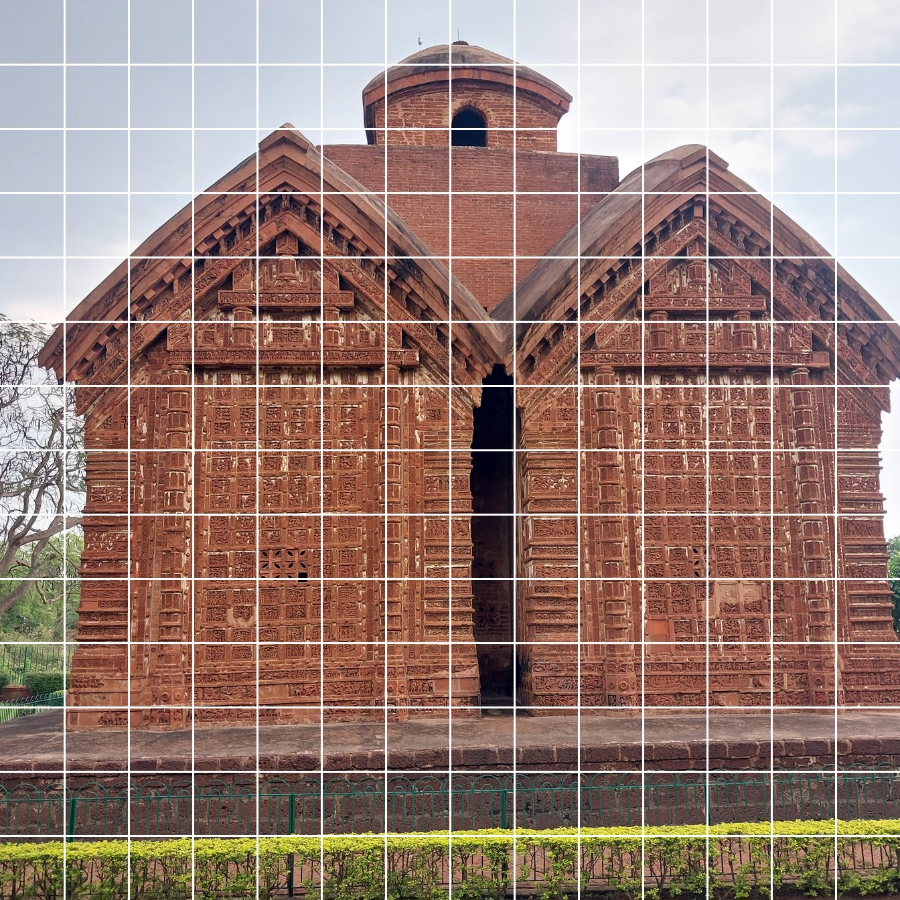

<figcaption>

Jor Bangla as ViT reads it: 14 × 14 = 196 patches, each 16 × 16 pixels at the model's 224 × 224 input. One photograph, one 196-word sentence. *Photo by the author, March 2025.*

</figcaption>

</figure>

For a 224 × 224 photo that's (224 / 16)² = **196 patches**. Each patch holds 16 × 16 × 3 = **768 raw numbers**, and a learned linear projection maps it to a vector of size *D*. In ViT-Base, *D* is also 768. That's a coincidence of the Base size, not a rule: ViT-Large projects the same 768-number patches to 1,024. The paper's three sizes (Table 1):

| model | layers | hidden size *D* | MLP size | heads | params |
|---|---|---|---|---|---|
| **ViT-Base** (built here, patch 16) | 12 | 768 | 3072 | 12 | 86M |
| ViT-Large | 24 | 1024 | 4096 | 16 | 307M |
| ViT-Huge | 32 | 1280 | 5120 | 16 | 632M |

---

## 5. Why ViT matters in this series

The [Transformer](https://samyamoyrakshit.com/blog/attention-from-scratch/) introduced the architecture for translation. [BERT](https://samyamoyrakshit.com/blog/bert-from-scratch/) kept only the encoder and showed that pre-training once and fine-tuning everywhere beats training per task. ViT is the step where the architecture stops being about language at all. Almost every part of it is borrowed, and the paper says so:

| | Transformer (2017) | BERT (2018) | ViT (2020) |
|---|---|---|---|
| stack | encoder + decoder | encoder only | encoder only |
| tokens | byte-pair subwords | WordPiece subwords | **16 × 16 patches, via a Conv2d** |
| positions | sinusoidal, fixed | learned, 1D | learned, 1D |
| readout | decoder → softmax | pooled `[CLS]` | `[class]` token (Eq. 4) |
| LayerNorm | after each sub-layer | after each sub-layer | **before** each sub-layer |
| activation | ReLU | GELU | GELU |
| pre-training | none | self-supervised (MLM + NSP) | supervised (ImageNet-21k, JFT-300M) |

The `[class]` token is lifted straight from BERT: *"Similar to BERT's [class] token, we prepend a learnable embedding to the sequence of embedded patches."* The authors even tried BERT's objective on pixels. They corrupted 50% of patch embeddings, 80% of those to a learnable `[mask]`, 10% to a random other patch and 10% left as they were, *"very similar to the one used for language by Devlin et al."* That's the same [80/10/10 trick](https://samyamoyrakshit.com/blog/bert-from-scratch/) from the BERT post. Predicting each corrupted patch's mean colour, ViT-B/16 reached 79.9% on ImageNet: 2 points better than training from scratch, but still 4 behind supervised pre-training.

The bigger reason ViT matters is what it made possible. Once an image is a sequence of tokens, it can share a model with text. That is why ViTs sit inside so much of what came next: CLIP's image encoders, the vision tower LLaVA connects to a language model, and SAM's image encoder. For anyone who has built BERT, nothing after the patch embedding is new. That is the point.

---

## 6. The architecture, and where 85,806,346 parameters live

<style>
  /* Presentation attributes on each element are the always-works layer (plain
     hex, survives any renderer that strips this block). These rules re-style the
     same elements through the site tokens — CSS beats a presentation attribute,
     so on the site the diagram themes with the ThemeToggle. */
  .dgm{background:var(--code-bg, oklch(0.97 0.0022 95));border:1px solid var(--rule, oklch(0.868 0.0038 95));border-radius:14px;padding:20px 14px;overflow-x:auto;margin:1.6rem 0}
  .dgm svg{display:block;width:100%;height:auto;margin:0 auto}
  .dgm text{font-family:var(--f-mono, ui-monospace,SFMono-Regular,Menlo,monospace)}
  .dg-xink{fill:var(--ink, oklch(0.23 0.023 258))}
  .dg-xmut{fill:var(--ink-muted, oklch(0.42 0.021 258))}
  .dg-xaccent{fill:var(--accent, oklch(0.47 0.175 268))}
  .dg-xamberfg{fill:var(--tint-amber-fg, oklch(0.445 0.09 65))}
  .dg-xskyfg{fill:var(--tint-sky-fg, oklch(0.435 0.114 250))}
  .dg-xvioletfg{fill:var(--tint-violet-fg, oklch(0.44 0.145 300))}
  .dg-xmintfg{fill:var(--tint-mint-fg, oklch(0.42 0.081 168))}
  .dg-node{fill:var(--paper-sunken, oklch(0.902 0.0034 95));stroke:var(--rule, oklch(0.868 0.0038 95))}
  .dg-leafno{fill:var(--paper-sunken, oklch(0.902 0.0034 95));stroke:var(--rule, oklch(0.868 0.0038 95))}
  .dg-amber{fill:var(--tint-amber-bg, oklch(0.942 0.042 85));stroke:var(--tint-amber-fg, oklch(0.445 0.09 65))}
  .dg-sky{fill:var(--tint-sky-bg, oklch(0.933 0.033 245));stroke:var(--tint-sky-fg, oklch(0.435 0.114 250))}
  .dg-violet{fill:var(--tint-violet-bg, oklch(0.933 0.031 300));stroke:var(--tint-violet-fg, oklch(0.44 0.145 300))}
  .dg-mintbox{fill:var(--tint-mint-bg, oklch(0.933 0.035 165));stroke:var(--tint-mint-fg, oklch(0.42 0.081 168))}
  .dg-flow{stroke:var(--ink-muted, oklch(0.42 0.021 258))}
  .dg-mem{stroke:var(--accent, oklch(0.47 0.175 268))}
  .dg-group{stroke:var(--rule-strong, oklch(0.615 0.006 95))}
  .dg-ahflow{fill:var(--ink-muted, oklch(0.42 0.021 258))}
  .dg-ahmem{fill:var(--accent, oklch(0.47 0.175 268))}
  /* On a phone, scroll the diagram rather than shrink it — same reasoning as
     the Transformer post: these viewBoxes are 700 wide, and fitting one into a
     358px column scales the 10.5-14px labels down to 5-7px. A flow chart whose
     labels cannot be read is decoration. The container already scrolls. */
  @media (max-width: 40rem){
    .dgm svg{min-width:620px}
  }
</style>
<figure class="dgm">
  <svg viewBox="0 0 700 840" width="700" height="840" style="max-width:100%;height:auto" font-family="ui-monospace, SFMono-Regular, Menlo, Consolas, monospace" role="img" aria-label="The Vision Transformer as built in this notebook: a 224 by 224 temple photo is cut by a 16-pixel convolution into 196 patch vectors of 768 numbers, a learnable class token is prepended, a learned position embedding is added, and the 197-token sequence passes through 12 pre-norm encoder blocks of multi-head attention and a GELU MLP, each wrapped in a residual connection. Only the class token is read out, through LayerNorm and a linear layer, into 10 logits, one per temple.">
    <defs><marker id="dgahV-flow" viewBox="0 0 9 9" refX="7.5" refY="4.5" markerWidth="6.5" markerHeight="6.5" orient="auto-start-reverse"><path class="dg-ahflow" d="M0,0 L9,4.5 L0,9 z" fill="#464e59"/></marker><marker id="dgahV-res" viewBox="0 0 9 9" refX="7.5" refY="4.5" markerWidth="6.5" markerHeight="6.5" orient="auto-start-reverse"><path class="dg-ahmem" d="M0,0 L9,4.5 L0,9 z" fill="#324ebb"/></marker></defs>
    <rect class="dg-node" x="170" y="14" width="340" height="50" rx="12" fill="#dfdfdc" stroke="#d4d3d1" stroke-width="1.4"/>
    <text class="dg-lbl dg-xink dg-c" x="340.0" y="36" fill="#161d28" font-size="14" font-weight="600" text-anchor="middle">Temple photograph</text>
    <text class="dg-sub dg-xink dg-c" x="340.0" y="53" fill="#161d28" font-size="11" font-weight="400" text-anchor="middle">RGB, resized to 224 × 224</text>
    <text class="dg-tag dg-xmut" x="528" y="44" fill="#464e59" font-size="11" font-weight="400" text-anchor="start" letter-spacing=".02em">(B, 3, 224, 224)</text>
    <path class="dg-flow" d="M340,64 L340,88" fill="none" stroke="#464e59" stroke-width="1.8" stroke-linecap="round" marker-end="url(#dgahV-flow)"/>
    <rect class="dg-sky" x="170" y="90" width="340" height="64" rx="12" fill="#d7ecfe" stroke="#0f538d" stroke-width="1.4"/>
    <text class="dg-lbl dg-xskyfg dg-c" x="340.0" y="112" fill="#0f538d" font-size="14" font-weight="600" text-anchor="middle">Patch embedding</text>
    <text class="dg-sub dg-xskyfg dg-c" x="340.0" y="129" fill="#0f538d" font-size="11" font-weight="400" text-anchor="middle">Conv2d(3→768, kernel 16, stride 16)</text>
    <text class="dg-sub dg-xskyfg dg-c" x="340.0" y="144" fill="#0f538d" font-size="11" font-weight="400" text-anchor="middle">14 × 14 grid → flatten → 196 patches</text>
    <text class="dg-tag dg-xmut" x="528" y="126" fill="#464e59" font-size="11" font-weight="400" text-anchor="start" letter-spacing=".02em">(B, 196, 768)</text>
    <text class="dg-tag dg-xaccent" x="150" y="126" fill="#324ebb" font-size="11" font-weight="600" text-anchor="end">Eq. 1</text>
    <path class="dg-flow" d="M340,154 L340,178" fill="none" stroke="#464e59" stroke-width="1.8" stroke-linecap="round" marker-end="url(#dgahV-flow)"/>
    <rect class="dg-sky" x="170" y="180" width="340" height="50" rx="12" fill="#d7ecfe" stroke="#0f538d" stroke-width="1.4"/>
    <text class="dg-lbl dg-xskyfg dg-c" x="340.0" y="202" fill="#0f538d" font-size="14" font-weight="600" text-anchor="middle">Prepend [class] token</text>
    <text class="dg-sub dg-xskyfg dg-c" x="340.0" y="219" fill="#0f538d" font-size="11" font-weight="400" text-anchor="middle">one learnable 768-vector, as in BERT</text>
    <text class="dg-tag dg-xmut" x="528" y="210" fill="#464e59" font-size="11" font-weight="400" text-anchor="start" letter-spacing=".02em">(B, 197, 768)</text>
    <path class="dg-flow" d="M340,230 L340,254" fill="none" stroke="#464e59" stroke-width="1.8" stroke-linecap="round" marker-end="url(#dgahV-flow)"/>
    <rect class="dg-sky" x="170" y="256" width="340" height="50" rx="12" fill="#d7ecfe" stroke="#0f538d" stroke-width="1.4"/>
    <text class="dg-lbl dg-xskyfg dg-c" x="340.0" y="278" fill="#0f538d" font-size="14" font-weight="600" text-anchor="middle">Add position embedding</text>
    <text class="dg-sub dg-xskyfg dg-c" x="340.0" y="295" fill="#0f538d" font-size="11" font-weight="400" text-anchor="middle">learned 197 × 768 table, then dropout</text>
    <text class="dg-tag dg-xmut" x="528" y="286" fill="#464e59" font-size="11" font-weight="400" text-anchor="start" letter-spacing=".02em">(B, 197, 768)</text>
    <rect class="dg-group" x="170" y="340" width="340" height="332" rx="14" fill="none" stroke="#868581" stroke-width="1.3" stroke-dasharray="5 4"/>
    <text class="dg-hd dg-xvioletfg" x="528" y="362" fill="#603995" font-size="12" font-weight="700" text-anchor="start" letter-spacing=".12em">ENCODER BLOCK × 12</text>
    <text class="dg-tag dg-xmut" x="528" y="379" fill="#464e59" font-size="10.5" font-weight="400" text-anchor="start">12 copies, own weights</text>
    <path class="dg-flow" d="M340,306 L340,376" fill="none" stroke="#464e59" stroke-width="1.8" stroke-linecap="round" marker-end="url(#dgahV-flow)"/>
    <rect class="dg-violet" x="215" y="378" width="250" height="30" rx="9" fill="#ece5fb" stroke="#603995" stroke-width="1.4"/>
    <text class="dg-lbl dg-xvioletfg dg-c" x="340.0" y="398.0" fill="#603995" font-size="14" font-weight="600" text-anchor="middle">LayerNorm</text>
    <path class="dg-flow" d="M340,408 L340,422" fill="none" stroke="#464e59" stroke-width="1.8" stroke-linecap="round" marker-end="url(#dgahV-flow)"/>
    <rect class="dg-violet" x="215" y="424" width="250" height="46" rx="10" fill="#ece5fb" stroke="#603995" stroke-width="1.4"/>
    <text class="dg-lbl dg-xvioletfg dg-c" x="340.0" y="446" fill="#603995" font-size="14" font-weight="600" text-anchor="middle">Multi-head attention</text>
    <text class="dg-sub dg-xvioletfg dg-c" x="340.0" y="463" fill="#603995" font-size="11" font-weight="400" text-anchor="middle">12 heads × 64 dims</text>
    <text class="dg-tag dg-xaccent" x="150" y="451" fill="#324ebb" font-size="11" font-weight="600" text-anchor="end">Eq. 2</text>
    <path class="dg-flow" d="M340,470 L340,484" fill="none" stroke="#464e59" stroke-width="1.8" stroke-linecap="round" marker-end="url(#dgahV-flow)"/>
    <circle class="dg-node" cx="340" cy="496" r="10" fill="#dfdfdc" stroke="#324ebb" stroke-width="1.6"/>
    <path class="dg-mem" d="M335,496 H345 M340,491 V501" fill="none" stroke="#324ebb" stroke-width="1.8" stroke-linecap="round"/>
    <path class="dg-mem" d="M340,358 H192 V496 H328" fill="none" stroke="#324ebb" stroke-width="2.2" stroke-linecap="round" stroke-linejoin="round" marker-end="url(#dgahV-res)"/>
    <circle class="dg-ahmem" cx="340" cy="358" r="3.2" fill="#324ebb"/>
    <path class="dg-flow" d="M340,506 L340,530" fill="none" stroke="#464e59" stroke-width="1.8" stroke-linecap="round" marker-end="url(#dgahV-flow)"/>
    <rect class="dg-violet" x="215" y="532" width="250" height="30" rx="9" fill="#ece5fb" stroke="#603995" stroke-width="1.4"/>
    <text class="dg-lbl dg-xvioletfg dg-c" x="340.0" y="552.0" fill="#603995" font-size="14" font-weight="600" text-anchor="middle">LayerNorm</text>
    <path class="dg-flow" d="M340,562 L340,576" fill="none" stroke="#464e59" stroke-width="1.8" stroke-linecap="round" marker-end="url(#dgahV-flow)"/>
    <rect class="dg-violet" x="215" y="578" width="250" height="46" rx="10" fill="#ece5fb" stroke="#603995" stroke-width="1.4"/>
    <text class="dg-lbl dg-xvioletfg dg-c" x="340.0" y="600" fill="#603995" font-size="14" font-weight="600" text-anchor="middle">MLP</text>
    <text class="dg-sub dg-xvioletfg dg-c" x="340.0" y="617" fill="#603995" font-size="11" font-weight="400" text-anchor="middle">768 → 3072 → 768, GELU</text>
    <text class="dg-tag dg-xaccent" x="150" y="605" fill="#324ebb" font-size="11" font-weight="600" text-anchor="end">Eq. 3</text>
    <path class="dg-flow" d="M340,624 L340,638" fill="none" stroke="#464e59" stroke-width="1.8" stroke-linecap="round" marker-end="url(#dgahV-flow)"/>
    <circle class="dg-node" cx="340" cy="650" r="10" fill="#dfdfdc" stroke="#324ebb" stroke-width="1.6"/>
    <path class="dg-mem" d="M335,650 H345 M340,645 V655" fill="none" stroke="#324ebb" stroke-width="1.8" stroke-linecap="round"/>
    <path class="dg-mem" d="M340,516 H192 V650 H328" fill="none" stroke="#324ebb" stroke-width="2.2" stroke-linecap="round" stroke-linejoin="round" marker-end="url(#dgahV-res)"/>
    <circle class="dg-ahmem" cx="340" cy="516" r="3.2" fill="#324ebb"/>
    <text class="dg-tag dg-xmut" x="528" y="500" fill="#464e59" font-size="11" font-weight="400" text-anchor="start" letter-spacing=".02em">(B, 197, 768)</text>
    <text class="dg-tag dg-xmut" x="528" y="520" fill="#464e59" font-size="10.5" font-weight="400" text-anchor="start">LayerNorm first,</text>
    <text class="dg-tag dg-xaccent" x="528" y="535" fill="#324ebb" font-size="10.5" font-weight="400" text-anchor="start">residual + after</text>
    <path class="dg-flow" d="M340,660 L340,698" fill="none" stroke="#464e59" stroke-width="1.8" stroke-linecap="round" marker-end="url(#dgahV-flow)"/>
    <rect class="dg-node" x="170" y="700" width="340" height="50" rx="12" fill="#dfdfdc" stroke="#d4d3d1" stroke-width="1.4"/>
    <text class="dg-lbl dg-xink dg-c" x="340.0" y="722" fill="#161d28" font-size="14" font-weight="600" text-anchor="middle">Keep token 0 only</text>
    <text class="dg-sub dg-xink dg-c" x="340.0" y="739" fill="#161d28" font-size="11" font-weight="400" text-anchor="middle">x[:, 0] — the [class] token</text>
    <text class="dg-tag dg-xmut" x="528" y="730" fill="#464e59" font-size="11" font-weight="400" text-anchor="start" letter-spacing=".02em">(B, 768)</text>
    <text class="dg-tag dg-xaccent" x="150" y="730" fill="#324ebb" font-size="11" font-weight="600" text-anchor="end">Eq. 4</text>
    <path class="dg-flow" d="M340,750 L340,774" fill="none" stroke="#464e59" stroke-width="1.8" stroke-linecap="round" marker-end="url(#dgahV-flow)"/>
    <rect class="dg-amber" x="170" y="776" width="340" height="50" rx="12" fill="#f9eacd" stroke="#754812" stroke-width="1.4"/>
    <text class="dg-lbl dg-xamberfg dg-c" x="340.0" y="798" fill="#754812" font-size="14" font-weight="600" text-anchor="middle">Classifier head</text>
    <text class="dg-sub dg-xamberfg dg-c" x="340.0" y="815" fill="#754812" font-size="11" font-weight="400" text-anchor="middle">LayerNorm → Linear(768 → 10)</text>
    <text class="dg-tag dg-xmut" x="528" y="806" fill="#464e59" font-size="11" font-weight="400" text-anchor="start" letter-spacing=".02em">(B, 10)</text>
    <text class="dg-tag dg-xmut" x="528" y="821" fill="#464e59" font-size="10.5" font-weight="400" text-anchor="start">one logit per temple</text>
  </svg>
</figure>

The whole model is four equations from the paper, each marked on the diagram:

$$
\begin{aligned}
\mathbf{z}_0 &= [\mathbf{x}_{\text{class}};\, \mathbf{x}_p^1\mathbf{E};\, \mathbf{x}_p^2\mathbf{E};\, \cdots;\, \mathbf{x}_p^N\mathbf{E}] + \mathbf{E}_{\text{pos}}, &&\mathbf{E} \in \mathbb{R}^{(P^2 \cdot C)\times D},\ \mathbf{E}_{\text{pos}} \in \mathbb{R}^{(N+1)\times D} &(1)\\
\mathbf{z}'_\ell &= \operatorname{MSA}(\operatorname{LN}(\mathbf{z}_{\ell-1})) + \mathbf{z}_{\ell-1}, &&\ell = 1 \ldots L &(2)\\
\mathbf{z}_\ell &= \operatorname{MLP}(\operatorname{LN}(\mathbf{z}'_\ell)) + \mathbf{z}'_\ell, &&\ell = 1 \ldots L &(3)\\
\mathbf{y} &= \operatorname{LN}(\mathbf{z}_L^0) &&&(4)
\end{aligned}
$$

Eq. 1 turns the image into 197 tokens. Eqs. 2 and 3 are one encoder block, repeated 12 times. Eq. 4 reads the answer off token 0, the `[class]` token, and ignores the other 196. Here is where the parameters sit:

| part | parameters |
|---|---|
| patch embedding: Conv2d, 768 kernels of 3 × 16 × 16, plus biases | 590,592 |
| `[class]` token (768) + position embedding (197 × 768) | 152,064 |
| 12 encoder blocks × 7,087,872 | 85,054,464 |
| classifier head: LayerNorm + Linear(768 → 10) | 9,226 |
| **total** | **85,806,346** |

99.1% of the model is the encoder blocks. The part that makes it a *vision* model, the patch embedding, is under 0.7%.

---

## 7. Walking the notebook

The notebook (`ViT/ViT.ipynb`) goes in the same order as the course chapter. Here is the flow, with the shapes that come out of each step.

### 7.1 Split, count, load

`DatasetSplitter` copies each temple folder in `data/` into `dataset/train` and `dataset/test` at 80/20, with a fixed seed. It skips the copy if `dataset/` already exists, so re-running is safe. A counting cell then checks that train + test = total for every class (✅ on all ten, 1,935 = 1,543 + 392).

Images are resized to 224 × 224, the training resolution in the paper's Table 3, and turned into tensors. That's the whole transform; there's no normalisation and no augmentation. `create_dataloaders` wraps both splits in `ImageFolder` with batch size 32 (the paper used 4,096), giving **49 training batches and 13 test batches**. The training loader shuffles; the test loader doesn't. Remember that.

A batch comes out as `(32, 3, 224, 224)`: PyTorch is channels-first. To plot one, `image.permute(1, 2, 0)` reorders it to the `(224, 224, 3)` that matplotlib expects.

### 7.2 Eq. 1: from photo to 196 tokens

The notebook first does the arithmetic by hand: `(224 * 224) / 16**2 = 196` patches, each `16 * 16 * 3 = 768` numbers, so the patch sequence for one image is `(196, 768)`. Then it slices a row of patches out of a temple photo, and then all 196 of them: the grid in the figure above.

The trick that makes this cheap: **a Conv2d with kernel size = stride = 16 *is* "cut into patches + multiply by **E**"**, in one operation. Each of its 768 kernels sees exactly one 3 × 16 × 16 patch at a time, never overlapping, so the output is one 768-vector per patch, laid out on a 14 × 14 grid. The convolution output-size formula confirms it: ⌊(224 + 2·0 − 16) / 16 + 1⌋ = 14. Flatten the grid and swap two axes, and you have a sequence:

```python
class PatchEmbedding(nn.Module):                       # abridged from the notebook
    def __init__(self, in_channels=3, patch_size=16, embedding_dim=768):
        super().__init__()
        self.patcher = nn.Conv2d(in_channels, embedding_dim,
                                 kernel_size=patch_size, stride=patch_size, padding=0)
        self.flatten = nn.Flatten(start_dim=2, end_dim=3)

    def forward(self, x):                # (B, 3, 224, 224)
        x = self.patcher(x)              # (B, 768, 14, 14)   one 768-vector per patch
        x = self.flatten(x)              # (B, 768, 196)
        return x.permute(0, 2, 1)        # (B, 196, 768)      sequence-first, like text
```

One quirk if you run it: the shape check in the notebook's `forward` reads the notebook-level `patch_size`, not `self.patch_size`. It's harmless here because both are 16.

### 7.3 The `[class]` token and the position embedding

A single learnable `(1, 1, 768)` vector is prepended with `torch.cat(..., dim=1)`, so the sequence goes from 196 to **197** tokens. A learnable `(1, 197, 768)` position embedding is then *added*, and it broadcasts across the batch. The demo cells initialise both with `torch.ones` so you can watch them land: in the printed tensor, the `[class]` row reads `2.0000` all the way across (one from the token, one from its position). The real model uses `torch.randn`.

### 7.4 Eqs. 2 and 3: the encoder block

`MultiHeadSelfAttentionBlock` is `LayerNorm` followed by `nn.MultiheadAttention(768, 12, batch_first=True)`, with query = key = value = the normalised input. `MLPBlock` is `LayerNorm → Linear(768, 3072) → GELU → Dropout → Linear(3072, 768) → Dropout`. The block adds the residuals:

```python
def forward(self, x):
    x = self.msa_block(x) + x    # Eq. 2: LN → MSA, then add the input back
    x = self.mlp_block(x) + x    # Eq. 3: LN → MLP, then add the input back
    return x
```

Input and output are both `(1, 197, 768)`, and `torchinfo` counts **7,087,872** parameters. The notebook then shows that PyTorch's `nn.TransformerEncoderLayer(d_model=768, nhead=12, dim_feedforward=3072, activation="gelu", batch_first=True, norm_first=True)` is the same block with the same 7,087,872 parameters. `norm_first=True` is the pre-LN choice from the table above. The default, `False`, would give you BERT's ordering instead.

### 7.5 Assembling ViT

```python
def forward(self, x):                                                   # abridged
    class_token = self.class_embedding.expand(x.shape[0], -1, -1)      # (B, 1, 768), a view, no copy
    x = self.patch_embedding(x)                                         # (B, 196, 768)
    x = torch.cat((class_token, x), dim=1)                              # (B, 197, 768)
    x = self.embedding_dropout(self.position_embedding + x)             # Eq. 1
    x = self.transformer_encoder(x)                                     # Eqs. 2–3, × 12
    return self.classifier(x[:, 0])                                     # Eq. 4: token 0 only → (B, 10)
```

`transformer_encoder` is an `nn.Sequential` of 12 independent blocks, and `classifier` is `LayerNorm → Linear(768, 10)`. The class defaults to 1,000 outputs for ImageNet; the notebook builds it with `num_classes=10`.

### 7.6 Training it from scratch

The optimiser follows the paper's Table 3 row for ViT-B on ImageNet-21k: Adam with β₁ = 0.9, β₂ = 0.999, learning rate 10⁻³ and weight decay 0.03. The paper never names its loss, so it's `CrossEntropyLoss`, the obvious choice for single-label classification. Then ten epochs of `engine.train`.

### 7.7 Transfer learning with `torchvision`'s ViT-B/16

```python
weights = torchvision.models.ViT_B_16_Weights.DEFAULT            # = IMAGENET1K_V1
pretrained_vit = torchvision.models.vit_b_16(weights=weights).to(device)
for p in pretrained_vit.parameters():
    p.requires_grad = False                                       # freeze all 85.8M
pretrained_vit.heads = nn.Linear(768, len(class_names)).to(device)   # train only these 7,690
transforms = weights.transforms()   # resize 256 → centre crop 224 → ImageNet mean/std
```

The last line matters as much as the weights. A pretrained model expects its inputs prepared the way its training data was, so this run uses torchvision's transforms (resize to 256, centre-crop to 224, normalise with ImageNet's mean and standard deviation), not the bare resize from section 7.1. Adam at 10⁻³ again (no weight decay this time), same ten epochs. On the M1's GPU (`mps`) it took 28.5 minutes, about 171 seconds an epoch, even though only the head was learning: every image still has to go forward through all 12 frozen blocks.

### 7.8 Save and predict

`save_model` writes the `state_dict`, **327 MB** on disk. `pred_and_plot_image` then classifies a photo kept in `dataset/custom_testing/`.

---

## 8. Results: same parameters, opposite outcomes

The pretrained model was at 71.9% test accuracy after one epoch and 88.9% after ten, with training accuracy above 97%. The from-scratch model's log is stranger:

| epoch | train loss | test loss | test acc (logged) | identical to always answering… |
|---|---|---|---|---|
| 1 | 2.8157 | 2.4768 | 0.2115 | Shyam Rai |
| 2 | 2.3958 | 2.4621 | 0.2115 | Shyam Rai |
| 3 | 2.3695 | 2.3375 | 0.2115 | Shyam Rai |
| 4 | 2.3295 | 2.3077 | 0.0889 | Radha Shyam |
| 5 | 2.3074 | 2.3127 | 0.0817 | Madan Mohan |
| 6 | 2.3204 | 2.4019 | 0.0889 | Radha Shyam |
| 7 | 2.3192 | 2.3154 | 0.2115 | Shyam Rai |
| 8 | 2.3172 | 2.2871 | 0.1490 | Jor Bangla |
| 9 | 2.2964 | 2.3223 | 0.0697 | Nandalal |
| 10 | 2.2949 | 2.2770 | 0.1490 | Jor Bangla |

**The same five accuracy values keep coming back, and that's not noise.** Each is the exact score of a model that gives one answer for all 392 test photos. The test `DataLoader` isn't shuffled, so `ImageFolder` serves the photos sorted by class. `engine.test_step` averages accuracy *per batch*, not per image. Under that metric, "always Shyam Rai" (the last class, which fills the final batches) scores exactly 0.2115, and "always Jor Bangla" scores exactly 0.1490. Every logged value matches one class's signature to four decimal places. At the end of every epoch, the model was a constant. Counted per image, "always Shyam Rai" is 64/392 = 16.3% and "always Jor Bangla" is 62/392 = 15.8%.

**The loss tells the same story.** A model that knows nothing, guessing uniformly over ten classes, scores ln 10 = 2.303. A model that knows only how common each temple is in the training set scores 2.252 on this test split. The run finished at 2.277. It learned roughly how often each temple appears, and nothing about what any of them looks like.

---

## 9. Why the from-scratch ViT learned nothing

### 9.1 Only 1,543 images for 85.8 million parameters

That's about 55,600 parameters per training image. The paper warns about exactly this, and not even at our scale. Its smallest pre-training set is ImageNet, about 840 times larger than ours, and even there: *"When trained on mid-sized datasets such as ImageNet without strong regularization, these models yield modest accuracies of a few percentage points below ResNets of comparable size."* ViT only wins at 14M–300M images: *"We find that large scale training trumps inductive bias."*

The inductive bias it means is what a CNN gets for free and a ViT doesn't. A convolution assumes that nearby pixels belong together and that a carved panel is the same panel wherever it appears. ViT assumes almost nothing. In the paper's words, *"the position embeddings at initialization time carry no information about the 2D positions of the patches and all spatial relations between the patches have to be learned from scratch."* Before it can tell Kalachand from Radha Madhab, a fresh ViT has to learn that patch 15 sits directly below patch 1. With 1,543 photographs of very similar buildings, it never got that far.

### 9.2 The recipe was never the paper's either

| | ViT-B on ImageNet-21k (paper, Table 3) | this notebook |
|---|---|---|
| training images | 14M | 1,543 |
| batch size | 4,096 | 32 |
| learning-rate warmup | 10,000 steps | none |
| total optimiser steps | ≈ 300,000 (90 epochs) | 490 (10 epochs) |
| learning-rate schedule | linear decay | constant 10⁻³ |
| input preprocessing | — | resize + `ToTensor`, no normalisation |

**The paper's warmup alone is 10,000 steps. This entire run was 490.** An 85.8M-parameter Transformer took Adam's full learning rate from its very first step, on batches 128 times smaller than the paper's. Collapsing onto one answer is the textbook result. The notebook's own closing note lists the missing pieces (warmup, decay, gradient clipping, and above all data), and none of them can be fixed by training longer on the same 1,543 images.

### 9.3 Why the frozen one works

torchvision's `IMAGENET1K_V1` weights were *"trained from scratch by using a modified version of DeIT's training recipe"* on ImageNet-1k, where they score 81.07% top-1. By the time they reach Bishnupur, the 12 blocks already turn any photograph into a `[class]` vector that encodes edges, textures, arches and silhouettes. Freezing them leaves one decision to learn: a 768 → 10 linear map, **7,690 numbers**, which 1,543 images can pin down comfortably. Same architecture, same data, same ten epochs, and the only thing that changed is everything the weights had already seen.

---

## 10. Where it falls short, and what's next

- **The metric is batch-averaged.** That's fine with a shuffled loader, but misleading with a class-sorted one, as the table above shows. The fix is to count correct predictions per image. Both headline accuracies here are the notebook's logged numbers.
- **No confusion matrix yet.** For this dataset the real question is whether the model mixes up the six laterite-stone *eka-ratna* temples, five of which share one neighbourhood. That's the next cell to write.
- **Only the head was trained.** Unfreezing the last two or three blocks with a small learning rate, plus augmentation (crops, flips, colour jitter), is the standard next step from 88.9%.
- **The classes are imbalanced 2.5×.** A per-class accuracy table would show whether Kalachand's 100 training images are enough.

---

## 11. Closing

The interesting part of this project was never going to be the architecture. After the Transformer and BERT, a ViT is a Conv2d and a `[class]` token away. It was finding out what a model with no built-in idea of "nearby" does with 1,543 photographs of very similar buildings. The answer: nothing at all, until it has seen a million other pictures first. The paper's headline is that large-scale training trumps inductive bias. The temples showed the other half: without the scale, there's nothing to trump with.

---

## 12. References

1. Dosovitskiy, A., Beyer, L., Kolesnikov, A., et al. (2021). *An Image is Worth 16x16 Words: Transformers for Image Recognition at Scale.* ICLR 2021. [arXiv:2010.11929](https://arxiv.org/abs/2010.11929)
2. Bourke, D. *Zero to Mastery: Learn PyTorch*, chapter 08, [PyTorch Paper Replicating](https://www.learnpytorch.io/08_pytorch_paper_replicating/). The source of the notebook's code and training utilities.
3. PyTorch. [`torchvision.models.vit_b_16`](https://docs.pytorch.org/vision/stable/models/generated/torchvision.models.vit_b_16.html), `ViT_B_16_Weights.IMAGENET1K_V1`.
4. Devlin, J., Chang, M.-W., Lee, K., Toutanova, K. (2019). *BERT: Pre-training of Deep Bidirectional Transformers for Language Understanding.* NAACL. [arXiv:1810.04805](https://arxiv.org/abs/1810.04805)
5. Vaswani, A., et al. (2017). *Attention Is All You Need.* NeurIPS. [arXiv:1706.03762](https://arxiv.org/abs/1706.03762)
6. Archaeological Survey of India. Information boards at the temples of Bishnupur, Bankura, West Bengal, India; transcribed on site, March 2025.
7. UNESCO World Heritage Centre. [Temples at Bishnupur, West Bengal](https://whc.unesco.org/en/tentativelists/1087/), Tentative List, ref. 1087.
8. Sahapedia. [Terracotta Temples of Bishnupur](http://www.sahapedia.org/terracotta-temples-of-bishnupur).
